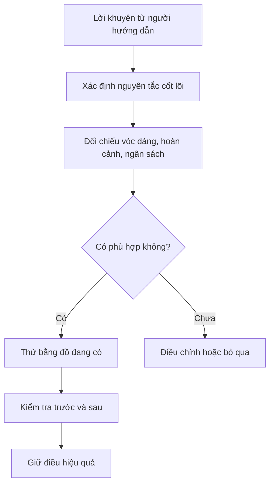

# Bài 002 — Michael Frackowiak là ai?

**Khóa học:** 25 Must-Have Men’s Wardrobe Pieces – Become a Fashion Icon  
**Module 01:** Introduction  
**Tên bài trên Udemy:** Who is Michael Frackowiak?  
**Loại nội dung:** Video lecture · **Thời lượng video:** 4 phút 06 giây  
**Trang khóa học:** https://www.udemy.com/course/25-must-have-mens-wardrobe-pieces-become-a-fashion-icon/

> [!SUMMARY] Tóm tắt
> Michael Frackowiak là người làm nghề may đo **bespoke** và tư vấn phong cách nam, từng có nền tảng trong ngành kỹ thuật. Tìm hiểu người hướng dẫn giúp bạn nhận ra điểm mạnh trong cách tiếp cận của ông: chú trọng độ vừa vặn, sự phù hợp với từng người và một tủ đồ có thể dùng thật trong đời sống.

> **Phạm vi:** Đây là bài học bổ trợ bằng tiếng Việt, tự biên soạn từ tên mục trong đề cương khóa học, thông tin công khai về người hướng dẫn và kiến thức chung. Không phải bản chép lời hoặc bản trích xuất nội dung video.

## 1. Tổng quan

Khi học về phong cách, câu hỏi đầu tiên không phải là “Nên mua áo gì?” mà là “Ai đang hướng dẫn mình, và người ấy nhìn trang phục từ góc độ nào?”. Người làm nội dung xu hướng, người tư vấn hình ảnh và thợ may đo có thể đưa ra những lời khuyên khác nhau, bởi họ quan sát quần áo theo những tiêu chí khác nhau.

Michael Frackowiak mang đến góc nhìn từ **công việc may đo và tư vấn trang phục nam**. Hiểu nền tảng đó giúp bạn tiếp thu nguyên tắc hữu ích nhưng vẫn đánh giá chúng theo vóc dáng, hoàn cảnh và ngân sách của riêng mình.

## 2. Mục tiêu học tập

Sau bài học, bạn có thể:

- [ ] Trình bày Michael Frackowiak là ai và lĩnh vực chuyên môn của ông.
- [ ] Phân biệt công việc của một **bespoke tailor** và một **style advisor**.
- [ ] Nêu hai lý do độ vừa vặn quan trọng hơn giá hoặc nhãn hiệu trong nhiều tình huống.
- [ ] Chọn một ý tưởng phong cách, thử với quần áo sẵn có và tự đánh giá kết quả.
- [ ] Nhận diện ít nhất hai trường hợp không nên áp dụng máy móc lời khuyên của một chuyên gia.

## 3. Michael Frackowiak là ai?

*Ảnh: [Victoria Jane McKenna – Michael Frackowiak Style Interview](https://www.victoriajanemckenna.com/style-interviews/michaelfrackowiak). Ảnh được nhúng từ trang nguồn; bản quyền thuộc chủ sở hữu ảnh.*

Michael Frackowiak được giới thiệu trên Udemy là người sáng tạo khóa học **25 Must-Have Men’s Wardrobe Pieces – Become a Fashion Icon**, với vai trò thợ may đo cao cấp và người hướng dẫn phong cách nam. Hồ sơ giảng viên ghi ông có MBA từ **Manchester Metropolitan University**.

Trước khi bước vào lĩnh vực trang phục, ông làm việc trong ngành **kỹ thuật điện**. Trong cuộc phỏng vấn công bố năm 2020, Michael cho biết ông chuyển sang nghề may đo khoảng giai đoạn 2014–2015, bắt đầu từ phụ kiện như khăn cài túi áo và sau đó phát triển sang may suit. Một bài báo năm 2023 cho biết ông sinh tại Ba Lan và phát triển sự nghiệp nghề may đo ở Liverpool, Anh.

Các thông tin này giúp xác định chuyên môn và quá trình nghề nghiệp của người hướng dẫn. Chúng không có nghĩa mọi lời khuyên đều đúng với mọi người.

### 3.1. Bespoke tailor là gì?

**Bespoke tailor** là thợ may tạo trang phục được thiết kế và điều chỉnh theo số đo, hình thể và yêu cầu của khách hàng. Trong quy trình bespoke truyền thống, trang phục thường có rập may riêng và các lần thử để tinh chỉnh.

Người thợ may không chỉ chú ý chiều dài hay vòng ngực. Họ còn quan sát vai, dáng đứng, chuyển động, tỷ lệ giữa thân áo và chân, cùng cách chất vải rủ trên người.

### 3.2. Style advisor là gì?

**Style advisor** là người tư vấn lựa chọn và kết hợp trang phục sao cho phù hợp với mục tiêu, hoàn cảnh và cá tính của người mặc. Công việc này có thể bao gồm kiểm kê tủ đồ, phối màu, lựa chọn mức độ trang trọng hoặc đề xuất món đồ cần bổ sung.

| Vai trò | Câu hỏi trọng tâm | Ví dụ |
| --- | --- | --- |
| Thợ may đo bespoke | Món đồ có vừa và tôn dáng người mặc không? | Chỉnh đường vai, dáng áo, chiều dài tay |
| Người tư vấn phong cách | Món đồ có phù hợp người mặc và hoàn cảnh không? | Chọn trang phục đi làm, dự tiệc, cuối tuần |
| Người học | Nguyên tắc nào phù hợp với nhu cầu thực tế của mình? | Thử phối áo sơ mi đang có với quần khác |

Michael kết hợp hai góc nhìn đầu tiên trong hoạt động nghề nghiệp và khóa học.

## 4. Triết lý phong cách đáng học hỏi

### 4.1. Độ vừa vặn là nền tảng

Một chiếc áo đắt nhưng phần vai quá rộng, tay quá dài hoặc thân áo căng kéo có thể trông kém hài hòa hơn chiếc áo bình dân vừa người. **Fit** (độ vừa vặn) là yếu tố có thể quan sát trực tiếp và nhiều khi cải thiện bằng chỉnh sửa đơn giản.

*Ảnh minh họa: Sebastian Hoofs, [Wikimedia Commons](https://commons.wikimedia.org/wiki/File:Bespoke_Tailor_is_taking_measurement.jpg), giấy phép [CC BY-SA 4.0](https://creativecommons.org/licenses/by-sa/4.0/); không chỉnh sửa.*

### 4.2. Trang phục phải phục vụ người mặc

Trong các cuộc tư vấn, Michael đề cập việc xem lại quần áo đang có, bỏ bớt những món không còn phù hợp và giữ những lựa chọn người mặc thực sự cần. Điều này gợi ý cách xây tủ đồ **có chủ đích**, không đồng nhất phong cách với số lượng quần áo.

Một bộ suit có thể thích hợp cho sự kiện trang trọng, nhưng không phải món bắt buộc phải mặc thường xuyên nếu đời sống chủ yếu là đi học hoặc làm việc trong môi trường thoải mái.

### 4.3. Chuyên môn là điểm xuất phát, không phải khuôn mẫu

Phong cách của người hướng dẫn có thể thiên về trang phục lịch sự và may đo. Người học có thể tiếp thu nguyên tắc về **fit, tỷ lệ, chất liệu và tính linh hoạt**, rồi áp dụng cho áo thun, quần jeans, chinos hoặc áo khoác thường ngày.

> [!TIP] Mẹo áp dụng
> Khi nghe lời khuyên “nên có món đồ X”, hãy tự hỏi: “Mình sẽ mặc nó trong những tình huống nào, bao nhiêu lần và có món nào đang sở hữu đáp ứng cùng nhu cầu không?”.

## 5. Cách đánh giá một lời khuyên về phong cách

Sơ đồ nhấn mạnh rằng **học từ chuyên gia không đồng nghĩa với sao chép nguyên xi**. Một người có thể giỏi may đo suit nhưng lời khuyên mua nhiều suit sẽ ít giá trị hơn đối với người hiếm khi mặc trang phục trang trọng.

Để đánh giá kết quả, hãy kiểm tra ba nhóm tiêu chí:

1. **Hình thức:** quần áo cân đối, vừa vặn, sạch sẽ và phù hợp hoàn cảnh.
2. **Trải nghiệm:** dễ đi lại, ngồi xuống, vận động và cảm thấy thoải mái.
3. **Tính thực dụng:** tận dụng được món đồ hiện có và không vượt ngân sách.

## 6. Ví dụ và bài tập thực hành

**Tình huống:** Bạn thích phong cách lịch sự của Michael nhưng chỉ có áo sơ mi xanh nhạt, quần chinos tối màu và giày sneaker trắng.

Bạn không nhất thiết cần mua suit mới. Trước tiên, có thể thử một bộ **smart casual** gồm áo sơ mi sơ vin gọn gàng, quần chinos phù hợp độ dài và sneaker sạch.

Thực hiện theo quy trình:

1. Chụp ảnh bộ đồ đang mặc ở góc chính diện và góc nghiêng.
2. Ghi **ba chi tiết** bạn muốn cải thiện, chẳng hạn vai áo, độ dài quần và sự đồng bộ màu sắc.
3. Chỉ chỉnh **một chi tiết** trước: sơ vin, xắn tay áo hoặc thay đổi cách phối giày.
4. Chụp ảnh sau chỉnh sửa trong cùng điều kiện ánh sáng và tư thế.
5. Đánh giá liệu bộ đồ có đẹp hơn, thoải mái hơn và hợp hoàn cảnh không.

**Bài tự làm:** Chọn một bộ trang phục nam bạn yêu thích từ tạp chí, website hoặc tủ đồ cá nhân. Viết lại ba nguyên tắc khiến bộ đồ hấp dẫn, sau đó chọn một nguyên tắc có thể áp dụng ngay với đồ đang có.

- [ ] Đã chọn một hình tham khảo.
- [ ] Đã ghi ba điểm tạo nên sức hút của trang phục.
- [ ] Đã thử một thay đổi không cần mua sắm.
- [ ] Đã lưu ảnh hoặc ghi chú kết quả.

## 7. Những kết luận cần tránh

**Trường hợp 1 — Đồng nhất giá tiền với phong cách:** Một bộ suit may đo có thể mang lại kết quả tốt cho người cần mặc thường xuyên, nhưng không chứng minh rằng người có ngân sách thấp không thể ăn mặc đẹp.

**Trường hợp 2 — Sao chép hình ảnh mà bỏ qua hoàn cảnh:** Phong cách phù hợp cho sự kiện doanh nghiệp ở Anh có thể không tiện dụng trong thời tiết nóng ẩm, môi trường học tập hoặc công việc thường ngày của bạn.

Vì vậy, hãy xem lời khuyên là **giả thuyết cần thử nghiệm**, không phải quy tắc bất biến.

## 8. Những lỗi thường gặp

- **Xem chuyên gia là hình mẫu phải bắt chước:** Học nguyên tắc phù hợp sẽ hữu ích hơn sao chép toàn bộ tủ đồ của họ.
- **Chỉ chú trọng nhãn hiệu:** Thương hiệu không thay thế được độ vừa vặn, sự thoải mái và chăm sóc quần áo.
- **Nhầm bespoke với đồ may sẵn:** Bespoke thường đòi hỏi quy trình đo, làm rập và thử chỉnh riêng; đồ may sẵn vẫn có thể phù hợp nếu lựa chọn đúng và chỉnh sửa khi cần.
- **Mua ngay sau khi xem lời khuyên:** Chưa kiểm kê tủ đồ dễ dẫn đến mua trùng hoặc không dùng tới.
- **Đổi nhiều chi tiết cùng lúc:** Không xác định được điều chỉnh nào thực sự cải thiện kết quả.

## 9. Câu hỏi ôn tập

### Câu 1

Nền tảng nghề nghiệp nào giải thích vì sao Michael Frackowiak chú trọng cấu trúc và độ vừa vặn của trang phục?

A. Huấn luyện thể thao  
B. Kỹ thuật và may đo bespoke  
C. Thiết kế nội thất  
D. Sản xuất giày thể thao  

**Đáp án:** B. **Giải thích:** Michael từng làm kỹ thuật trước khi chuyển sang nghề may đo, nơi việc quan sát cấu trúc và số đo là rất quan trọng.

### Câu 2

Điểm khác biệt chính giữa thợ may bespoke và người tư vấn phong cách là gì?

A. Người tư vấn phong cách chỉ chọn quần áo đắt tiền  
B. Thợ may bespoke chỉ chọn màu sắc  
C. Hai nghề không có sự khác nhau nào  
D. Thợ may chú trọng tạo và chỉnh trang phục theo cơ thể; người tư vấn chú trọng lựa chọn trang phục phù hợp người mặc và hoàn cảnh  

**Đáp án:** D. **Giải thích:** Hai vai trò có thể bổ trợ nhau nhưng không hoàn toàn giống nhau.

### Câu 3

Một người ít khi tham gia sự kiện trang trọng nên xử lý thế nào khi được khuyên mua nhiều bộ suit?

A. Đối chiếu nhu cầu thực tế, giữ nguyên tắc hữu ích và chưa vội mua  
B. Mua đủ ngay vì người hướng dẫn có chuyên môn  
C. Bỏ qua toàn bộ kiến thức về độ vừa vặn  
D. Chọn bộ đắt nhất bất kể ngân sách  

**Đáp án:** A. **Giải thích:** Lời khuyên cần được điều chỉnh theo tần suất sử dụng, hoàn cảnh và khả năng tài chính.

### Câu 4

Cách nào kiểm tra tốt nhất xem một thay đổi phối đồ có hiệu quả?

A. Chỉ dựa vào giá mua  
B. Hỏi thật nhiều người nhưng không mặc thử  
C. Thay một yếu tố, chụp ảnh trước và sau, đồng thời kiểm tra độ thoải mái  
D. Mua thêm ba món để so sánh  

**Đáp án:** C. **Giải thích:** Thử một thay đổi và quan sát trong điều kiện tương tự giúp đánh giá rõ tác dụng của từng yếu tố.

### Câu 5

Bài học quan trọng nhất khi tìm hiểu người hướng dẫn về phong cách là gì?

A. Mọi người cần mặc giống người hướng dẫn  
B. Hiểu chuyên môn của họ để chọn lọc và thử nghiệm những nguyên tắc thích hợp  
C. Trang phục lịch sự luôn tốt hơn trang phục đời thường  
D. Không cần xét đến khí hậu hay lối sống  

**Đáp án:** B. **Giải thích:** Chuyên môn giúp định hướng, nhưng trang phục tốt phải đáp ứng nhu cầu và đặc điểm riêng của người mặc.

## 10. Tổng kết

Michael Frackowiak mang đến góc nhìn giao thoa giữa **nghề may đo**, **tư vấn phong cách** và tư duy chú ý đến chi tiết. Điều đáng học không phải là sao chép phong cách cá nhân của ông, mà là biết quan sát độ vừa vặn, chọn quần áo phục vụ cuộc sống và kiểm tra kết quả trước khi mua thêm.

**Nhiệm vụ sau bài học:** Lưu một ảnh phong cách bạn thích, ghi ba chi tiết có thể học hỏi và áp dụng ít nhất một chi tiết vào bộ đồ đang có.

## 11. Tài liệu tham khảo và nguồn ảnh

1. [Udemy – Khóa học 25 Must-Have Men’s Wardrobe Pieces](https://www.udemy.com/course/25-must-have-mens-wardrobe-pieces-become-a-fashion-icon/) — tên bài, thời lượng, người hướng dẫn và mục tiêu khóa học.
2. [Udemy – Hồ sơ giảng viên Michael Frackowiak MBA](https://www.udemy.com/user/mike1975/) — nghề nghiệp và học vấn được công bố.
3. [Victoria Jane McKenna – Phỏng vấn Michael Frackowiak](https://www.victoriajanemckenna.com/style-interviews/michaelfrackowiak) — nền tảng kỹ thuật, quá trình chuyển nghề và quan điểm về trang phục.
4. [The National – The go-to tailor for football's dapper elite](https://www.thenationalnews.com/weekend/2023/12/15/i-have-to-look-better-than-mo-salah-the-go-to-tailor-for-footballs-dapper-elite/) — hành trình nghề may đo tại Anh.
5. [Wikimedia Commons – Bespoke Tailor is taking measurement](https://commons.wikimedia.org/wiki/File:Bespoke_Tailor_is_taking_measurement.jpg) — ảnh minh họa của Sebastian Hoofs, CC BY-SA 4.0.

> **Lưu ý về nguồn:** Các chi tiết tiểu sử lấy từ hồ sơ và phỏng vấn công khai. Các ví dụ, câu hỏi, bài tập và sơ đồ là nội dung học tập tự biên soạn, không phải phát biểu nguyên văn của Michael. Ảnh được nhúng qua URL của trang xuất bản, vì vậy cần Internet khi xem Markdown.
