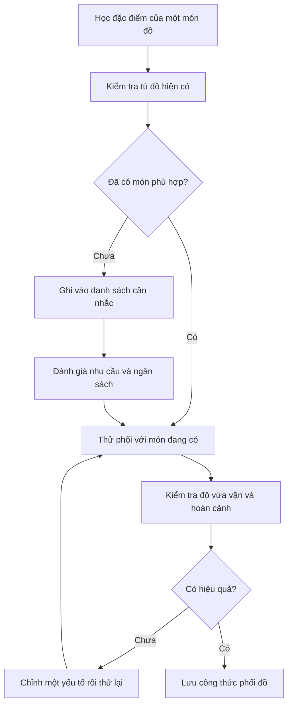

# Bài 003 — Khóa học sẽ diễn ra như thế nào?

**Khóa học:** 25 Must-Have Men’s Wardrobe Pieces – Become a Fashion Icon  
**Module 01:** Introduction  
**Bài giảng:** How this course is going to work?  
**Loại:** VIDEO_LECTURE · **Thời lượng bài gốc:** 2 phút 12 giây  
**Trang khóa học:** https://www.udemy.com/course/25-must-have-mens-wardrobe-pieces-become-a-fashion-icon/

> [!SUMMARY] Tóm tắt
> Học phong cách nam hiệu quả không phải là thuộc lòng danh sách món đồ cần mua. Bạn cần hiểu từng món dùng trong hoàn cảnh nào, nhận diện những gì đã có, thử kết hợp thành bộ trang phục và chỉ mua sắm khi xác định được nhu cầu thật sự.

> **Phạm vi:** Tài liệu học bổ trợ bằng tiếng Việt, biên soạn từ chủ đề và đề cương công khai của khóa học kết hợp với phương pháp thực hành. Không phải bản chép lời hoặc bản trích xuất video.

## 1. Tổng quan

Một tủ quần áo đầy ắp vẫn có thể khiến bạn mất nhiều thời gian chọn đồ mỗi sáng nếu các món không phối hợp được với nhau. Ngược lại, một tủ đồ gọn, có nhiều món linh hoạt và phù hợp đời sống có thể giúp việc mặc đẹp trở nên đơn giản hơn.

Bài học này giới thiệu **cách tổ chức việc học**, từ nhận diện các món trang phục thiết yếu đến thực hành phối đồ. Kết quả mong muốn không phải mua đủ 25 món ngay lập tức, mà là xây dựng một hệ thống lựa chọn trang phục có chủ đích.

*Hình 1. Bố trí các món đồ cạnh nhau giúp nhận biết màu sắc, chất liệu và khả năng phối hợp. Ảnh: NordWood Themes, [Wikimedia Commons](https://commons.wikimedia.org/wiki/File:Clothing_flatlay_(Unsplash).jpg), CC0 1.0.*

## 2. Mục tiêu học tập

Sau bài học, bạn có thể:

- [ ] Giải thích cấu trúc chính của khóa học và mục tiêu từng phần.
- [ ] Phân biệt món đồ thiết yếu với món đồ chỉ đang thịnh hành.
- [ ] Sắp xếp tủ đồ theo nhóm trang trọng, thường ngày và phụ kiện.
- [ ] Thử phối ít nhất hai bộ trang phục từ đồ đã có.
- [ ] Lập danh sách ưu tiên chỉnh sửa, giữ lại hoặc mua bổ sung dựa trên nhu cầu thực tế.

## 3. Cấu trúc khóa học

Theo đề cương hiển thị công khai trên Udemy, khóa học gồm **3 phần, 20 bài giảng**, tổng thời lượng khoảng **1 giờ 56 phút**. Phần học chính có 16 bài tập trung vào những loại quần áo, giày và phụ kiện điển hình.

| Phần | Nội dung | Mục tiêu của người học |
|---|---|---|
| **01 — Introduction** (3 bài) | Giới thiệu khóa học, người hướng dẫn và cách học | Biết mục tiêu và phương pháp tiếp cận |
| **02 — Wardrobe's Essential** (16 bài) | Suit, blazer, sơ mi, quần, đồ dệt kim, giày, áo khoác, cà vạt, khăn túi áo, thắt lưng... | Hiểu đặc tính từng nhóm và cách sử dụng |
| **03 — What have we learned in this course?** (1 bài) | Bắt đầu bằng việc dọn lọc tủ đồ | Biết giữ, loại bớt và bổ sung có chọn lọc |

> [!NOTE] Phân biệt tên khóa học và số lượng video
> Cụm **“25 Must-Have”** là tên/chủ đề của khóa học; **không có nghĩa là khóa học chứa đúng 25 bài giảng**. Các con số ở trên là cấu trúc công khai của khóa học tại thời điểm đối chiếu, không phải bản thống kê các món đồ độc lập.

### 3.1. Những nhóm trang phục sẽ gặp

Có thể gom các chủ đề thành bốn nhóm thực hành để dễ theo dõi:

| Nhóm | Ví dụ xuất hiện trong đề cương | Câu hỏi khi học |
|---|---|---|
| **Trang trọng / công sở** | Navy suit, blazer, dress shirt, grey trousers | Món nào phù hợp họp, phỏng vấn, sự kiện? |
| **Thường ngày / smart casual** | Knitwear, casual shirt, chinos, denim | Có thể mặc linh hoạt mà vẫn gọn gàng không? |
| **Giày và trang phục ngoài** | Oxford, Derby, white sneakers, overcoat | Khi nào nên chọn kiểu giày hoặc áo khoác nào? |
| **Phụ kiện hoàn thiện** | Necktie, pocket square, belt | Phụ kiện nào hữu ích, món nào chỉ là tùy chọn? |

Đây là **cách nhóm để học và ghi nhớ**, không phải tên bốn module chính thức của Udemy.

## 4. Quy trình học hiệu quả: Nhận diện → Kiểm kê → Thử phối → Đánh giá

Quy trình này nên được lặp lại khi học từng chủ đề. Việc **ghi vào danh sách cân nhắc không đồng nghĩa phải mua**: nếu không có nhu cầu dùng thường xuyên hoặc món đó vượt ngân sách, bạn có thể bỏ qua.

### 4.1. Trước khi xem một bài về trang phục

Xác định bối cảnh bạn thường gặp (đi học, đi làm, gặp bạn bè, phỏng vấn hoặc dịp trang trọng). Sau đó quan sát những món bạn đang có để đặt một câu hỏi cụ thể, ví dụ: *“Chiếc sơ mi trắng của mình có kết hợp tốt với quần hiện tại không?”*

### 4.2. Trong khi học

Với mỗi món đồ, hãy ghi ngắn gọn **công dụng — độ vừa vặn — màu sắc — chất liệu — cách phối — giới hạn sử dụng**. Đây là những tiêu chí thực tế giúp bạn biến kiến thức thành quyết định mặc đồ.

### 4.3. Sau khi học

Thử ngay một bộ trang phục trong gương hoặc ảnh chụp. Chú ý độ dài áo, đường vai, chiều dài quần và mức độ thoải mái khi đứng, ngồi, di chuyển. Mỗi lần chỉ thay một yếu tố để nhận ra sự khác biệt.

## 5. Học theo hoàn cảnh sử dụng, không chỉ theo danh sách món đồ

Một món đồ chỉ trở nên *thiết yếu* khi nó phục vụ nhu cầu của bạn. Ví dụ, người thường xuyên phải tham dự sự kiện trang trọng sẽ có nhu cầu với suit và giày da khác với người đi học trong môi trường thoải mái.

| Hoàn cảnh | Bộ trang phục ví dụ | Ưu tiên đánh giá |
|---|---|---|
| Đi học / gặp bạn | Áo thun hoặc sơ mi casual + jeans/chinos + sneakers | Thoải mái, sạch sẽ, dễ phối |
| Đi làm thường ngày | Sơ mi + chinos/quần âu + giày phù hợp | Gọn gàng, đúng văn hóa công sở |
| Hẹn gặp hoặc smart casual | Áo sơ mi + blazer + quần tối màu | Cân bằng giữa lịch sự và tự nhiên |
| Phỏng vấn / sự kiện trang trọng | Sơ mi + quần âu, có thể thêm suit khi dress code yêu cầu | Độ vừa vặn, tính phù hợp, sự chỉn chu |

*Hình 2. Một ví dụ smart casual: áo sơ mi và blazer phối cùng quần jeans. Ảnh: David M Tran, [Wikimedia Commons](https://commons.wikimedia.org/wiki/File:Smart_Casual_Dress_Example.jpg), CC BY-SA 3.0.*

## 6. Ví dụ minh họa: Học một món đồ rồi áp dụng ngay

**Tình huống:** Bạn vừa tìm hiểu về quần chinos và muốn biết có nên mua một chiếc hay không.

1. **Xác định nhu cầu:** Bạn muốn mặc đi học, đi làm bán thời gian và đi cà phê.
2. **Kiểm kê:** Bạn đã có jeans xanh đậm, quần âu đen, sơ mi trắng và áo polo xanh navy.
3. **Thử phối:** Phối sơ mi trắng với quần âu, rồi phối polo với jeans. Nếu đã đủ bộ đồ đáp ứng nhu cầu, chinos chưa phải ưu tiên.
4. **Đánh giá khoảng trống:** Nếu bạn thường xuyên cần một kiểu quần nằm giữa jeans và quần âu về mức độ lịch sự, chinos có thể đáng cân nhắc.
5. **Quyết định:** Chỉ mua khi bạn xác định được ít nhất vài cách phối thực sự sẽ mặc, kiểu dáng phù hợp và chi phí nằm trong ngân sách.

Mục đích là học cách **ra quyết định** chứ không phải tích lũy thêm quần áo.

## 7. Thực hành: Lập bản đồ tủ đồ cá nhân

**Bài tập:** Dành một buổi để chia tủ quần áo thành ba nhóm: trang trọng, thường ngày và phụ kiện. Với từng món, ghi lại tình trạng và mức độ sử dụng.

*Hình 3. Kiểm kê tủ đồ giúp nhận diện món đang dùng tốt và món cần chỉnh hoặc thay. Ảnh: Shixart1985, [Wikimedia Commons](https://commons.wikimedia.org/wiki/File:Man_organizing_clothes_in_wardrobe_while_choosing_outfit_in_a_stylish_room.jpg), CC BY 2.0.*

Sử dụng bảng mẫu sau:

| Nhóm | Món đang có | Tần suất mặc | Trạng thái | Hành động |
|---|---|---|---|---|
| Trang trọng | Sơ mi trắng | Hàng tuần | Vừa vặn | Giữ |
| Thường ngày | Jeans xanh đậm | Hàng tuần | Hơi dài | Cân nhắc sửa gấu |
| Phụ kiện | Thắt lưng đen | Thỉnh thoảng | Còn tốt | Giữ |
| Trang phục ngoài | Áo blazer | Chưa có | — | Chỉ cân nhắc nếu có nhu cầu |

**Checklist hoàn thành:**

- [ ] Phân loại được quần áo hiện có theo tối thiểu ba nhóm.
- [ ] Tìm được ba món mặc thường xuyên nhất.
- [ ] Phối thử ít nhất hai bộ đồ mà không mua mới.
- [ ] Chụp ảnh và ghi lại một điểm cần cải thiện cho mỗi bộ.
- [ ] Xác định nhóm ưu tiên rà soát và không mua trước khi kiểm tra nhu cầu.

## 8. Những lỗi thường gặp

- **Xem hết video nhưng không áp dụng:** Không có buổi thử phối hoặc kiểm kê, nên kiến thức dễ bị quên.
- **Mặc định mọi món trong khóa học đều bắt buộc phải mua:** Nhu cầu phụ thuộc công việc, thời tiết, ngân sách và phong cách riêng.
- **Mua theo danh sách trước khi kiểm kê:** Có thể mua trùng hoặc mua món khó phối với quần áo hiện có.
- **Đánh giá bằng một tấm ảnh duy nhất:** Ánh sáng, góc chụp và tư thế có thể gây sai lệch; nên kiểm tra nhiều góc và thử vận động.
- **Thay nhiều thứ cùng lúc:** Khó biết sự cải thiện đến từ áo, quần, giày hay cách sơ vin.

> [!TIP] Mẹo học nhanh
> Sau mỗi bài về một món đồ, hãy ghi **một câu “Tôi dùng món này khi…”** và **một hành động có thể thử ngay**. Hai dòng ghi chú hữu ích hơn một danh sách mua sắm không có ưu tiên.

## 9. Câu hỏi ôn tập

### Câu 1

Theo cấu trúc công khai của khóa học, phần nào tập trung vào những món trang phục nam thiết yếu?

A. Introduction  
B. Wardrobe's Essential  
C. What have we learned in this course?  
D. Không có phần nào về trang phục  

**Đáp án:** B. **Giải thích:** Phần Wardrobe's Essential bao gồm các chủ đề như suit, blazer, sơ mi, quần, giày và phụ kiện.

### Câu 2

Bạn vừa học về blazer nhưng chưa có chiếc nào. Bước tiếp theo phù hợp nhất là gì?

A. Mua ngay chiếc đắt nhất  
B. Bỏ hết áo khoác đang có  
C. Mua hai chiếc khác màu để thử  
D. Xem blazer có cần cho hoàn cảnh của mình và phối được với đồ đang có không  

**Đáp án:** D. **Giải thích:** Sự cần thiết, mức độ sử dụng và khả năng phối hợp nên được đánh giá trước khi mua.

### Câu 3

Vì sao cần kiểm kê tủ đồ trước khi lập danh sách mua sắm?

A. Để biết món nào đã có, món nào dùng tốt và điều gì thật sự còn thiếu  
B. Để tăng số lượng đồ phải mua  
C. Để chỉ giữ lại quần áo đắt tiền  
D. Để mặc giống hoàn toàn người hướng dẫn  

**Đáp án:** A. **Giải thích:** Kiểm kê giảm mua trùng, giúp ưu tiên đồ có thể dùng thực tế.

### Câu 4

Sau khi học một cách phối trang phục, cách kiểm tra hiệu quả nào đáng tin cậy nhất?

A. Chỉ dựa vào giá tiền  
B. Chỉ dựa vào hình quảng cáo  
C. Thử mặc, kiểm tra độ vừa vặn và sự thoải mái, chụp ảnh nhiều góc  
D. Thay toàn bộ quần áo cùng một lúc  

**Đáp án:** C. **Giải thích:** Kết hợp quan sát với trải nghiệm mặc giúp phát hiện vấn đề về hình thức và công năng.

### Câu 5

Phát biểu nào phù hợp nhất với phương pháp học trong bài?

A. Mọi học viên phải sở hữu đúng 25 món đồ mới hoàn thành khóa học  
B. Mỗi bài học nên dẫn đến một quan sát hoặc thử nghiệm nhỏ trong đời thực  
C. Đồ đang thịnh hành luôn phù hợp với tất cả mọi người  
D. Học phối đồ không cần xét hoàn cảnh sử dụng  

**Đáp án:** B. **Giải thích:** Mục tiêu là hình thành năng lực lựa chọn và phối đồ, không phải mua đủ món theo một danh sách cố định.

## 10. Tổng kết kiến thức

- Khóa học được tổ chức từ giới thiệu, tìm hiểu các nhóm trang phục thiết yếu đến dọn lọc tủ đồ.
- Với mỗi món, hãy học **công dụng, độ vừa vặn, màu sắc, chất liệu, cách phối và giới hạn sử dụng**.
- Quy trình thực hành hiệu quả là **nhận diện → kiểm kê → thử phối → đánh giá → điều chỉnh**.
- Chỉ mua món mới khi có nhu cầu thực, có cách phối rõ ràng và phù hợp ngân sách.

**Sản phẩm học tập:** Một bảng kiểm kê tủ đồ, hai công thức phối trang phục có ảnh tham chiếu và một danh sách tối đa ba điều cần điều chỉnh trước tiên.

## 11. Tài liệu tham khảo và nguồn hình

1. [Udemy — 25 Must-Have Men’s Wardrobe Pieces - Become a Fashion Icon](https://www.udemy.com/course/25-must-have-mens-wardrobe-pieces-become-a-fashion-icon/) — đề cương, các bài học và thời lượng công khai.
2. [NordWood Themes — Clothing flatlay](https://commons.wikimedia.org/wiki/File:Clothing_flatlay_(Unsplash).jpg) — CC0 1.0.
3. [David M Tran — Smart Casual Dress Example](https://commons.wikimedia.org/wiki/File:Smart_Casual_Dress_Example.jpg) — CC BY-SA 3.0.
4. [Shixart1985 — Man organizing clothes in wardrobe](https://commons.wikimedia.org/wiki/File:Man_organizing_clothes_in_wardrobe_while_choosing_outfit_in_a_stylish_room.jpg) — CC BY 2.0.

*Các hình được nhúng bằng URL trực tuyến và cần kết nối Internet để hiển thị. Phần quy trình, ví dụ và bài tập là tài liệu học bổ trợ tự biên soạn; không phải nội dung chép từ video.*
