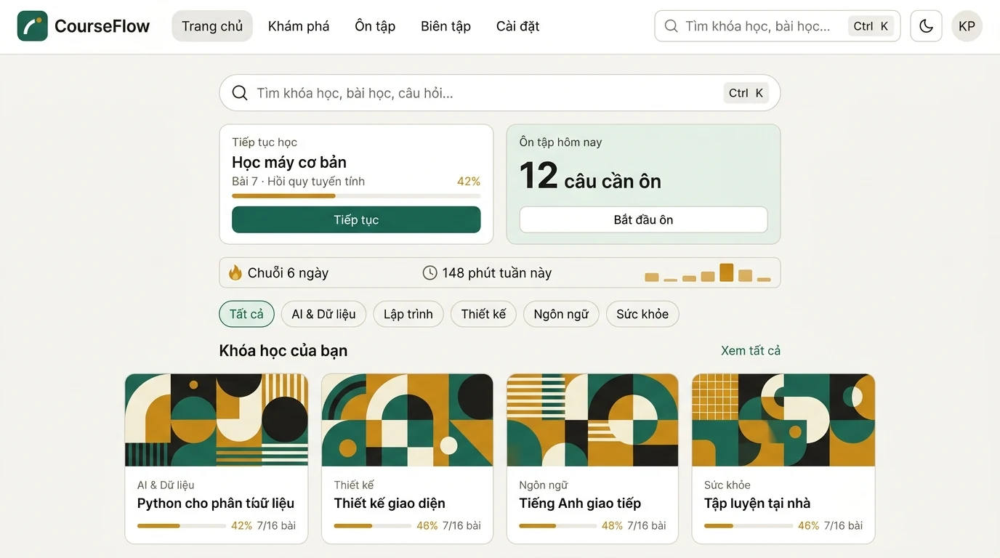
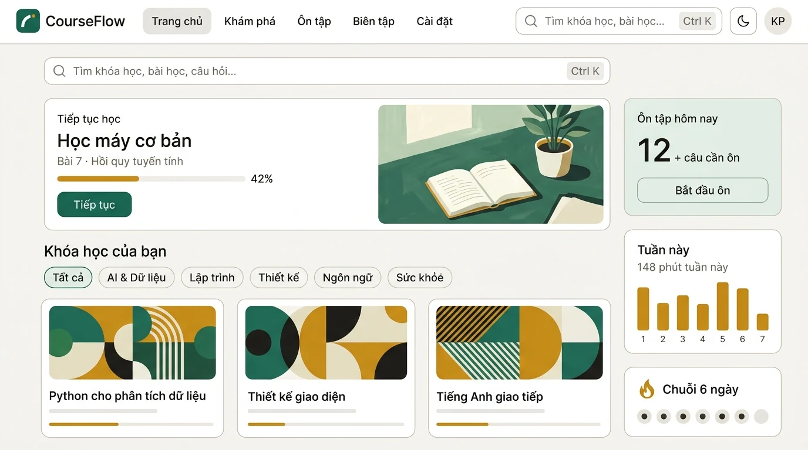
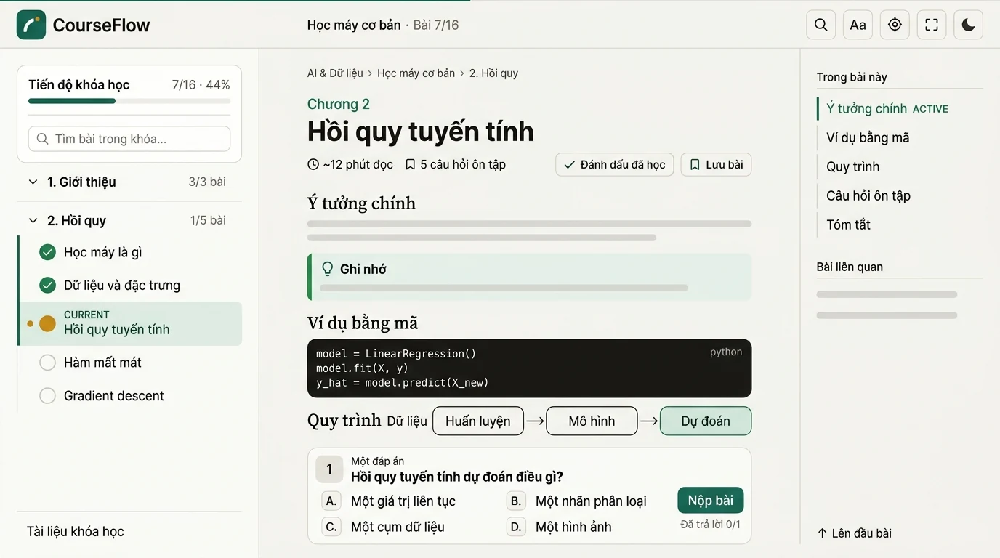
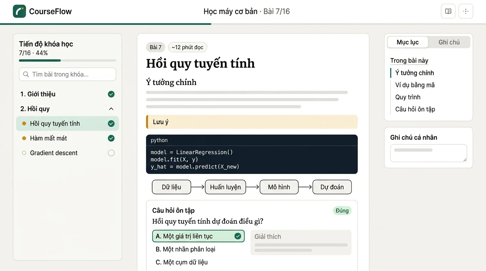
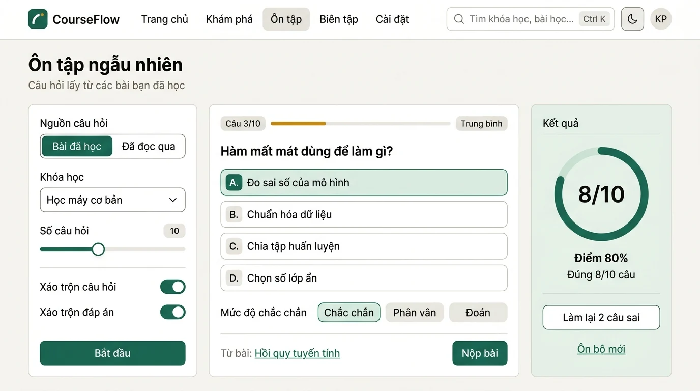
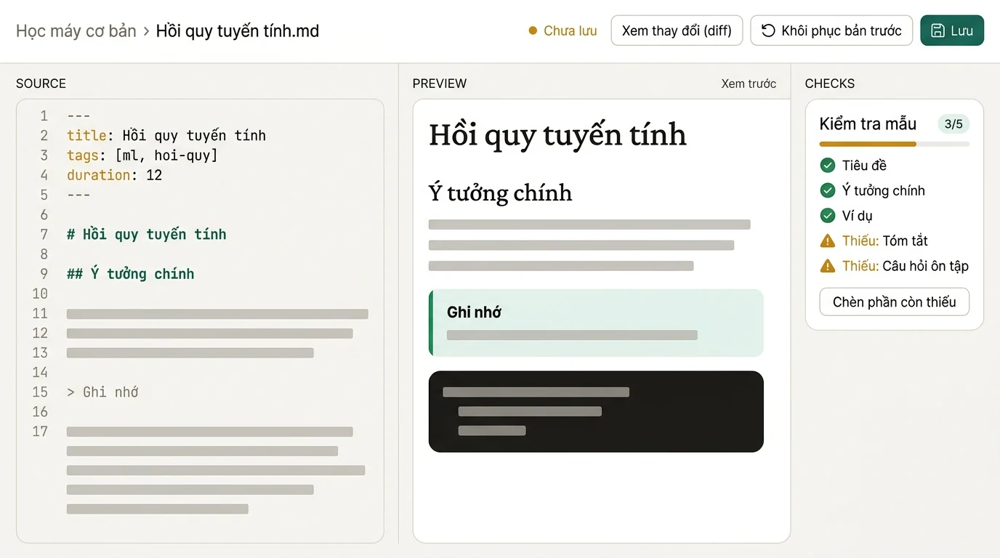
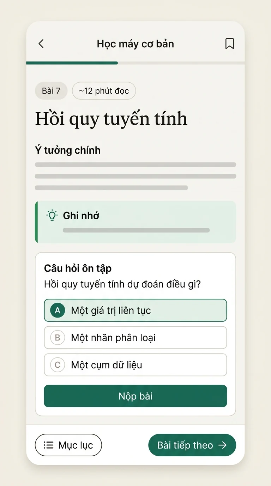
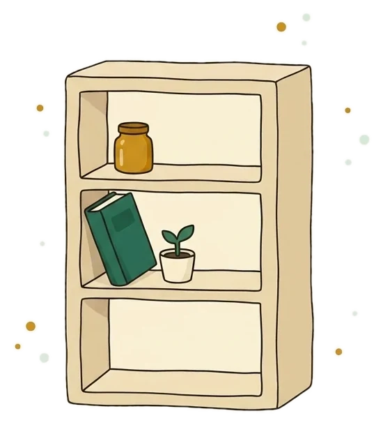

# CourseFlow design explorations

Generated mockups and illustration assets for CourseFlow. Everything here follows [`DESIGN_TEMPLATE.md`](DESIGN_TEMPLATE.md) (read from the real app tokens and components). Mockups are idea explorations of that template, not pixel specs: values in the template win over anything an image shows.

## Status and engines

All requested files exist: 7 mockups (5 required + the two `-v2` variants) and 6 illustration assets, every image reviewed by eye before acceptance and stored as WebP (Pillow q88, no PNG/JPG kept in the repo; each asset is under 150 KB).

- **Codex image generation: not usable.** The 1-image test (red apple icon) failed with `usage_limit_reached` ("try again at Nov 15th, 2026 8:07 PM"), so everything was made with Antigravity.
- **Antigravity (`agy`, sub-agent `image-generator`) was flaky for about 1.5 hours**: after the first batch it answered `429 RESOURCE_EXHAUSTED` ("capacity exhausted", reset announced for 17:44 UTC) on roughly 9 of 10 calls, with occasional successes; parallel calls (3 at once) made it worse, so the later runs used 1-2 workers plus an automatic retry loop. It worked again the next morning (7 of 9 calls succeeded in the first two runs) but still rejected the `reader` retries.
- **Process order.** `DESIGN_TEMPLATE.md` was written first from the real code (`globals.css`, `ReaderShell`, `CourseOutline`, `LessonActions`, `QuizRunner`, `QuestionCard`, `SiteHeader`, `TableOfContents`); a first round of mockups made before the template existed was thrown away (wrong nav labels, no persona line, garbled code in the editor); all mockups below were regenerated from the template, with its structure and exact Vietnamese strings written into each prompt. The illustrations were generated last, after choosing the mockup ideas, with the chosen style attached as a reference.
- **Regenerations (at most once each):** `dashboard` (literal "Domain" labels and a truncated search placeholder in v1), `editor` (duplicate `Lưu` and duplicate check button in v1). `reader` could NOT be regenerated: the fixed prompt (in `jobs-template.json`) was rejected by the quota on 9 tries spread over 20 minutes, so the first version was kept and its two leaked annotation words ("CURRENT" in the outline, "ACTIVE" in the TOC) were painted out with Pillow (flat fill, no other change). The prompt listed below for `reader` is the one that produced the image, including those two cue words; the fixed wording is in the job file. Re-run: `python design/_work/gen.py design/_work/jobs-template.json --engine agy --par 1 --force --only reader`.
- **Known text defects that remain** (mockups are ideas, not specs): one garbled course title on `dashboard` ("phân tíửu liệu"), English pane captions on `editor`, a stray "+" on `dashboard-v2`. Do not copy any text from the images; copy strings from `DESIGN_TEMPLATE.md`.
- `design/_work/` keeps only the generator script, job files (`jobs-*.json`) and prompt text so any image can be re-made; all intermediate PNG/JPG were deleted.

Every prompt started with the persona line:

> Bạn là nhà thiết kế giao diện web đẹp, chuyên nghiệp (an expert designer of beautiful, modern web interfaces).

Images came from the Antigravity CLI (`agy`, sub-agent `image-generator`, model `gemini-3.1-flash-image`, JPEG ~1376x768 or 1024x1024, converted to WebP q88). Codex image generation was tried first with a 1-image test and failed with `usage_limit_reached` (reopens 15 Nov 2026 20:07), so it was not used.

## Files

| File | Engine | Size | What it is |
|---|---|---|---|
| `design/mockups/dashboard.webp` | agy | 64 KB | Dashboard (template layout) |
| `design/mockups/dashboard-v2.webp` | agy | 74 KB | Dashboard variation B (hero illustration + right rail) |
| `design/mockups/reader.webp` | agy | 64 KB | Three-column lesson reader |
| `design/mockups/reader-v2.webp` | agy | 51 KB | Reader variation B (paper card + tabbed right panel) |
| `design/mockups/practice.webp` | agy | 61 KB | Random review page with score ring |
| `design/mockups/editor.webp` | agy | 45 KB | Split-view Markdown editor with template check |
| `design/mockups/reader-mobile.webp` | agy | 40 KB | Mobile reader, portrait 9:16 |
| `public/illus/empty-courses.webp` | agy | 27 KB | Illustration: 'No courses yet' |
| `public/illus/empty-progress.webp` | agy | 38 KB | Illustration: 'Nothing learned yet' |
| `public/illus/empty-search.webp` | agy | 28 KB | Illustration: 'No search results' |
| `public/illus/empty-review.webp` | agy | 50 KB | Illustration: 'Nothing due today' |
| `public/illus/hero-study.webp` | agy | 54 KB | Illustration: Dashboard hero (16:9) |
| `public/illus/quiz-perfect.webp` | agy | 28 KB | Illustration: 100 % quiz score |
| `design/DESIGN_TEMPLATE.md` | — | — | UI template for the 5 screens |

## Which ideas were chosen, and why

The app has already adopted four ideas that these explorations also show, so they are **not** new work: Bauhaus geometric course covers, the `Ôn tập hôm nay` card beside `Tiếp tục học`, the 7-day activity bars, and confidence buttons (`Chắc chắn` / `Phân vân` / `Đoán`) on quiz cards.

Ideas picked as worth adopting next, with the reason:

| Idea | From | Why |
|---|---|---|
| Hero `Tiếp tục học` card with an illustration, plus a right rail for review / week / streak | `dashboard-v2` | Gives the dashboard identity and warmth without photos; groups all "today" information in one column; the illustration is exactly the `hero-study` asset |
| Course progress block (`Tiến độ khóa học`, count, 6px bar, search field) at the top of the reader outline, current lesson as a soft-green row | `reader`, `reader-v2` | Orientation before navigation; the soft-green row is readable at 16px and costs no extra elements |
| Tabbed right panel `Mục lục` / `Ghi chú` and graded review card (`Đúng` pill + `Giải thích` block) | `reader-v2` | Adds notes without a fourth column and shows the QuizRunner feedback state clearly |
| Three non-overlapping columns (filters / question / result) with a full circular score ring and `Làm lại 2 câu sai` | `practice` | Settings, task and outcome never compete; a full ring reads faster than a semicircle gauge |
| Single editor toolbar (`Chưa lưu` dot, `Xem thay đổi (diff)`, `Khôi phục bản trước`, `Lưu`) + `Kiểm tra mẫu` panel with `3/5` and `Thiếu: …` rows | `editor` | State and actions on one line; the missing-section list turns the lesson template into a checklist |
| Fixed bottom bar with `Mục lục` pill and `Bài tiếp theo →`, 48px option rows | `reader-mobile` | The two thumb actions stay reachable; the app currently has a floating `Mục lục` pill only |

Illustration style was derived from the chosen `dashboard-v2` hero card and the geometric covers: flat gouache shapes in deep green, mint, amber, cream and sand with a thin ink outline, matte grain and a flat `#f6f5f1` background. Nothing glossy, no people, no text.

## Mockups

### `dashboard.webp`



Idea: Search hero + Continue/Review pair + stats strip + chips + 4-up course grid under the real top bar.

Layout ideas worth adopting:

- The full-width 56px search field as the page hero (no greeting headline) makes the dashboard feel like a tool; keep the `Ctrl K` hint chip inside it.
- Continue (white) next to Review (soft green) at equal height: the tint alone separates a task from a study action. (Already adopted in the app: `Ôn tập hôm nay` beside `Tiếp tục học`.)
- Stats strip in ONE thin bordered row (flame + `Chuỗi 6 ngày`, clock + `148 phút tuần này`, 7-day amber bars at the right) keeps the band calm; amber stays reserved for progress and streak. (7-day bars already adopted.)
- Course card = geometric cover, small domain overline (`AI & Dữ liệu`, `Thiết kế`…), 2-line title, thin amber bar with `%` and `7/16 bài` on one line; the domain chip row doubles as the grid filter. (Bauhaus geometric covers already adopted.)
- New: a green `Xem tất cả` link aligned right of the section title `Khóa học của bạn`; 24px gutters and 32px band spacing.

Avoid:

- One course title came out garbled ("Python cho phân tíửu liệu"): image models misspell long Vietnamese strings, so keep sample titles short and never copy text from the mockup into code.
- In the first attempt the prompt role name 'domain overline' was printed literally as "Domain" on every card and the narrow top-bar search showed a truncated placeholder ("Bàt"): pass real strings and give the field ~260px (this version fixes both).
- The content column is narrower than the cover grid (the 4 cards poke out of the 8+4 band above): align all bands to the same column edges.

<details><summary>Prompt used (full text, engine agy)</summary>

```text
Bạn là nhà thiết kế giao diện web đẹp, chuyên nghiệp (an expert designer of beautiful, modern web interfaces).

Brief: design a polished high-fidelity UI mockup of one screen of CourseFlow, a calm premium personal learning web app (between Notion, Linear and Coursera), following the DESIGN TEMPLATE below. Render it flat and crisp like a real screenshot at desktop 1440x900 proportions: no device frame, no browser chrome, no perspective, no 3D, no mockup scene. Theme: warm 'paper and ink' light theme. Page background warm off-white #f6f5f1, card surfaces pure white #ffffff, 1px hairline borders #e2ded3, primary text near-black ink #1d1c19, muted text warm grey #6c685e, hover fills #efede6. ONE accent only: deep green-teal #1e6b58 (primary buttons, selected states, links) with soft tint #e2efe9 for selected rows, chips and callouts; amber #c98a14 ONLY for in-progress bars, the streak flame and warnings; success green #2d8a57 for check icons. Typeface: Be Vietnam Pro (geometric humanist sans) for all UI text; Literata (serif) for long reading text and big question prompts. Shapes: pill chips, 12px-radius buttons and inputs, 16px-radius (rounded-2xl) cards with hairline borders, almost no shadows, generous whitespace, 8px spacing grid, clear typographic hierarchy (36/30/20/16/14/12 px scale). The logo mark is a small deep-green rounded square with a white curved stroke and a tiny amber dot, followed by the wordmark "CourseFlow". Icons: thin 1.75px line icons (lucide style). It must NOT look like a generic purple-gradient SaaS dashboard: no purple, no neon, no glassmorphism, no stock photos, no photos of people, no fake star ratings, no fake enrollment numbers. ALL on-screen text is Vietnamese with CORRECT diacritics, spelled exactly as quoted below; keep text short and represent any other body copy with light grey placeholder lines instead of inventing words. Never print annotation words such as 'active', 'current', 'selected', 'domain', 'label', 'placeholder' or 'on' anywhere on the screen: only the quoted strings appear as text, every other piece of copy is a grey bar. Crisp sharp text, no blur, no garbled or invented letters.

DESIGN TEMPLATE — SCREEN: Dashboard (home). Single centred content column about 1280px wide inside the 1440 canvas, 24px gutters, 32px vertical rhythm between bands.
Top bar (56px, white, 1px bottom border): logo mark + "CourseFlow" at the left; nav links "Trang chủ", "Khám phá", "Ôn tập", "Biên tập", "Cài đặt" (active one has a light grey-beige pill background and darker text); at the right a compact search field about 260px wide, wide enough to show its full placeholder "Tìm khóa học, bài học…" without truncation, with a "Ctrl K" key hint, a moon theme-toggle icon button and a round avatar with initials "KP".
Component order, top to bottom:
1) SEARCH HERO: a big search field 56px high, rounded-2xl, white, hairline border, magnifier icon, placeholder "Tìm khóa học, bài học, câu hỏi…", a "Ctrl K" key-hint chip at the right end. No greeting headline.
2) A row of two equal-height cards (about 176px high), 8 of 12 columns + 4 of 12 columns. LEFT white card: small overline label "Tiếp tục học", course title "Học máy cơ bản" (18px semibold), muted line "Bài 7 · Hồi quy tuyến tính", an amber progress bar with "42%" at its right, and a solid deep-green button "Tiếp tục". RIGHT card with soft green tint #e2efe9: overline "Ôn tập hôm nay", a big number "12" (40px bold) next to the text "câu cần ôn", and a white outlined button "Bắt đầu ôn".
3) A slim stats strip, one line with no heavy card: an amber flame icon + "Chuỗi 6 ngày", a clock icon + "148 phút tuần này", and a tiny 7-bar weekly sparkline in amber (today's bar solid).
4) A row of domain filter chips (pill, hairline border, first one selected with soft green fill and green text): "Tất cả", "AI & Dữ liệu", "Lập trình", "Thiết kế", "Ngôn ngữ", "Sức khỏe".
5) Section title "Khóa học của bạn" (20px semibold) with a small muted link "Xem tất cả" at the right.
6) A grid of 4 course cards in one row, 20px gap. Each card: white, rounded-2xl, hairline border; a 16:9 cover on top made of an abstract geometric flat pattern (circles, arcs, stripes, grids) in deep green, amber, cream and ink — each cover different, no photos; below: a small muted domain overline (exactly "AI & Dữ liệu", "Thiết kế", "Ngôn ngữ", "Sức khỏe" for the four cards in order), the title (max 2 lines), a thin amber progress bar with a percentage and a muted line like "7/16 bài". Titles exactly: "Python cho phân tích dữ liệu", "Thiết kế giao diện", "Tiếng Anh giao tiếp", "Tập luyện tại nhà".
Margins generous, everything aligned to the grid, nothing cramped, nothing overlapping.
```
</details>

### `dashboard-v2.webp`



Idea: Variation B: hero `Tiếp tục học` card with an illustration, right rail (review, week chart, streak), 3-up course grid.

Layout ideas worth adopting:

- The hero card carries a calm painted desk illustration at its right (the `hero-study` asset): the text block stays left (title, `Bài 7 · Hồi quy tuyến tính`, amber bar `42%`, `Tiếp tục`), so the dashboard gets a warm identity without photos.
- A narrow right rail for `Ôn tập hôm nay` / week bars / streak keeps all 'today' information in one scannable column and lets the course grid stay 3-up.
- The streak card with 7 day dots (6 filled) is a lighter way to show consistency than a big number.

Avoid:

- Stray "+" before `câu cần ôn` and a redundant `148 phút tuần này` under the title `Tuần này`: ask for the number once.
- Weekday labels were drawn as 1–7: use short Vietnamese weekday initials (`T2`…`CN`) in the real UI.
- The right rail starts above the hero card baseline (search field does not span it): decide whether search spans the whole width or only the main column.

<details><summary>Prompt used (full text, engine agy)</summary>

```text
Bạn là nhà thiết kế giao diện web đẹp, chuyên nghiệp (an expert designer of beautiful, modern web interfaces).

Brief: design a polished high-fidelity UI mockup of one screen of CourseFlow, a calm premium personal learning web app (between Notion, Linear and Coursera), following the DESIGN TEMPLATE below. Render it flat and crisp like a real screenshot at desktop 1440x900 proportions: no device frame, no browser chrome, no perspective, no 3D, no mockup scene. Theme: warm 'paper and ink' light theme. Page background warm off-white #f6f5f1, card surfaces pure white #ffffff, 1px hairline borders #e2ded3, primary text near-black ink #1d1c19, muted text warm grey #6c685e, hover fills #efede6. ONE accent only: deep green-teal #1e6b58 (primary buttons, selected states, links) with soft tint #e2efe9 for selected rows, chips and callouts; amber #c98a14 ONLY for in-progress bars, the streak flame and warnings; success green #2d8a57 for check icons. Typeface: Be Vietnam Pro (geometric humanist sans) for all UI text; Literata (serif) for long reading text and big question prompts. Shapes: pill chips, 12px-radius buttons and inputs, 16px-radius (rounded-2xl) cards with hairline borders, almost no shadows, generous whitespace, 8px spacing grid, clear typographic hierarchy (36/30/20/16/14/12 px scale). The logo mark is a small deep-green rounded square with a white curved stroke and a tiny amber dot, followed by the wordmark "CourseFlow". Icons: thin 1.75px line icons (lucide style). It must NOT look like a generic purple-gradient SaaS dashboard: no purple, no neon, no glassmorphism, no stock photos, no photos of people, no fake star ratings, no fake enrollment numbers. ALL on-screen text is Vietnamese with CORRECT diacritics, spelled exactly as quoted below; keep text short and represent any other body copy with light grey placeholder lines instead of inventing words. Never print annotation words such as 'active', 'current', 'selected', 'domain', 'label', 'placeholder' or 'on' anywhere on the screen: only the quoted strings appear as text, every other piece of copy is a grey bar. Crisp sharp text, no blur, no garbled or invented letters.

DESIGN TEMPLATE — SCREEN: Dashboard (home), VARIATION B (same components and strings as the template, different arrangement). Same top bar, same colours and card styles.
Top bar (56px, white, 1px bottom border): logo mark + "CourseFlow" at the left; nav links "Trang chủ", "Khám phá", "Ôn tập", "Biên tập", "Cài đặt" (active one has a light grey-beige pill background and darker text); at the right a compact search field about 260px wide, wide enough to show its full placeholder "Tìm khóa học, bài học…" without truncation, with a "Ctrl K" key hint, a moon theme-toggle icon button and a round avatar with initials "KP".
Arrangement: below the top bar, a big search field (56px, rounded-2xl, placeholder "Tìm khóa học, bài học, câu hỏi…", "Ctrl K" hint). Then a two-column layout inside a ~1280px column: MAIN column (about 8 of 12 columns) and a narrow RIGHT RAIL (4 of 12 columns).
MAIN column: (a) a wide white "Tiếp tục học" card with a calm flat gouache illustration of a quiet desk with an open notebook and a potted plant at its right side (green, cream, amber tones, no text in the illustration); at its left: overline "Tiếp tục học", title "Học máy cơ bản", muted "Bài 7 · Hồi quy tuyến tính", amber progress bar with "42%", solid green button "Tiếp tục". (b) Section title "Khóa học của bạn" with domain chips "Tất cả" (selected), "AI & Dữ liệu", "Lập trình", "Thiết kế", "Ngôn ngữ", "Sức khỏe". (c) A 3-column grid of course cards with abstract geometric flat covers (circles, arcs, stripes in green, amber, cream, ink) and titles "Python cho phân tích dữ liệu", "Thiết kế giao diện", "Tiếng Anh giao tiếp", each with a thin amber progress bar.
RIGHT RAIL (stacked cards, 16px gap): a soft green card (#e2efe9) with overline "Ôn tập hôm nay", big "12" + "câu cần ôn" and a button "Bắt đầu ôn"; a white card "Tuần này" with "148 phút tuần này" and a 7-bar weekly chart with amber bars; a white card with an amber flame icon and "Chuỗi 6 ngày" plus a row of 7 small day dots (6 filled).
Generous whitespace, aligned grid, calm and premium.
```
</details>

### `reader.webp`



Idea: Three-column reader at real widths: 320px outline, 736px article, 256px TOC.

Layout ideas worth adopting:

- Course progress block at the top of the outline (label, `7/16 · 44%`, 6px bar, search field) before the module list: orientation first, navigation second.
- Current lesson as a soft-green row with dark-green text; status icons (green check / amber dot / empty circle) are legible at 16px.
- Article hierarchy works: eyebrow, 36px title, meta row with clock icon, two pill actions, then 17px reading text with callout, dark code block and flow diagram all sharing the 12px radius.
- Review card at the end of the article as a soft shell with an inner white card (number badge, type label, 2x2 options, `Nộp bài`) reads as a clearly separate activity.
- Right TOC with a thin rule and a 2px green active marker; `Bài liên quan` and `Lên đầu bài` below keep the column useful.

Avoid:

- Annotation words leaked onto the screen ("CURRENT" in the outline, "ACTIVE" in the TOC) because the prompt used capitalised cues; they were painted out in post for the shipped file. Describe state visually, never with a keyword, and add 'no extra caption'.
- The `Quy trình` heading ended up on the same line as the diagram (cramped): ask for the heading and the diagram on separate lines.
- Outline has only 5 lessons so the left column looks empty at the bottom; fine for a mockup, but real courses will fill it.

<details><summary>Prompt used (full text, engine agy)</summary>

```text
Bạn là nhà thiết kế giao diện web đẹp, chuyên nghiệp (an expert designer of beautiful, modern web interfaces).

Brief: design a polished high-fidelity UI mockup of one screen of CourseFlow, a calm premium personal learning web app (between Notion, Linear and Coursera), following the DESIGN TEMPLATE below. Render it flat and crisp like a real screenshot at desktop 1440x900 proportions: no device frame, no browser chrome, no perspective, no 3D, no mockup scene. Theme: warm 'paper and ink' light theme. Page background warm off-white #f6f5f1, card surfaces pure white #ffffff, 1px hairline borders #e2ded3, primary text near-black ink #1d1c19, muted text warm grey #6c685e, hover fills #efede6. ONE accent only: deep green-teal #1e6b58 (primary buttons, selected states, links) with soft tint #e2efe9 for selected rows, chips and callouts; amber #c98a14 ONLY for in-progress bars, the streak flame and warnings; success green #2d8a57 for check icons. Typeface: Be Vietnam Pro (geometric humanist sans) for all UI text; Literata (serif) for long reading text and big question prompts. Shapes: pill chips, 12px-radius buttons and inputs, 16px-radius (rounded-2xl) cards with hairline borders, almost no shadows, generous whitespace, 8px spacing grid, clear typographic hierarchy (36/30/20/16/14/12 px scale). The logo mark is a small deep-green rounded square with a white curved stroke and a tiny amber dot, followed by the wordmark "CourseFlow". Icons: thin 1.75px line icons (lucide style). It must NOT look like a generic purple-gradient SaaS dashboard: no purple, no neon, no glassmorphism, no stock photos, no photos of people, no fake star ratings, no fake enrollment numbers. ALL on-screen text is Vietnamese with CORRECT diacritics, spelled exactly as quoted below; keep text short and represent any other body copy with light grey placeholder lines instead of inventing words. Crisp sharp text, no blur, no garbled or invented letters.

DESIGN TEMPLATE — SCREEN: Lesson reader, three columns at 1440px: LEFT outline 320px (white, right hairline border, full height), CENTRE reading column (article about 736px wide, centred in the remaining space, 48px side padding), RIGHT table of contents 256px.
Slim reader top bar (52px, bottom hairline) with a 2px deep-green reading-progress line along the very top edge: at the left the small logo mark, then the course name "Học máy cơ bản" and muted "· Bài 7/16"; at the right five small icon buttons (search, text-size "Aa", focus, fullscreen, moon).
LEFT OUTLINE, top to bottom: a block with a bottom border containing the label "Tiến độ khóa học" with "7/16 · 44%" at the right, a thin 6px progress bar, and a small search field "Tìm bài trong khóa…"; then module headers (13px semibold, small chevron, muted count) "1. Giới thiệu" (collapsed, "3/3 bài") and "2. Hồi quy" (expanded, "1/5 bài") with a thin vertical rule at the left of its lessons; lesson rows with a status icon and title: "Học máy là gì" (green check-circle), "Dữ liệu và đặc trưng" (green check-circle), "Hồi quy tuyến tính" (CURRENT: soft green #e2efe9 row, dark green text, amber dot icon), "Hàm mất mát" (empty grey circle), "Gradient descent" (empty grey circle); at the bottom a small overline "Tài liệu khóa học".
CENTRE ARTICLE, top to bottom: tiny breadcrumb "AI & Dữ liệu › Học máy cơ bản › 2. Hồi quy"; a green eyebrow "Chương 2"; big title "Hồi quy tuyến tính" (36px bold sans); a meta row with a clock icon "~12 phút đọc" and "5 câu hỏi ôn tập"; two pill buttons "Đánh dấu đã học" and "Lưu bài"; then the article in Literata serif 17px with grey placeholder lines: heading "Ý tưởng chính", two placeholder lines, a callout (soft green fill, 3px green left bar, lightbulb icon, bold label "Ghi nhớ", one placeholder line), heading "Ví dụ bằng mã", a dark ink code block (#1d1c19 background, rounded 12px, small language tag "python") containing exactly these three short lines: "model = LinearRegression()", "model.fit(X, y)", "y_hat = model.predict(X_new)"; heading "Quy trình", a clean flow diagram of four rounded boxes joined by arrows left to right labelled exactly "Dữ liệu", "Huấn luyện", "Mô hình", "Dự đoán" (the last box filled soft green); finally a review question card (soft #fbfaf7 shell with rounded-3xl corners containing a white rounded-2xl card) with a numbered badge "1", the label "Một đáp án", prompt "Hồi quy tuyến tính dự đoán điều gì?", four option rows each with a letter badge: "A. Một giá trị liên tục", "B. Một nhãn phân loại", "C. Một cụm dữ liệu", "D. Một hình ảnh", and a green button "Nộp bài" with the small muted text "Đã trả lời 0/1".
RIGHT TOC: small uppercase overline "Trong bài này", a thin vertical rule with items "Ý tưởng chính" (ACTIVE: 2px green left border, green text), "Ví dụ bằng mã", "Quy trình", "Câu hỏi ôn tập", "Tóm tắt"; below it an overline "Bài liên quan" with two muted link lines; at the bottom a small "↑ Lên đầu bài".
Reading-first, quiet, spacious.
```
</details>

### `reader-v2.webp`



Idea: Variation B: article on a white paper card, tabbed right panel (`Mục lục` / `Ghi chú`), graded option state.

Layout ideas worth adopting:

- Article on a white paper card over the off-white page separates reading from chrome; the segmented tabs `Mục lục` / `Ghi chú` give a notes slot (`Ghi chú cá nhân` textarea) without a fourth column.
- Graded feedback pattern for the review card: selected option green with a check, a small `Đúng` pill top-right, and a muted `Giải thích` block beside the options.
- Compact outline header (`Tiến độ khóa học`, `7/16 · 44%`, bar, search) with module rows that show a check at the right edge when completed.
- Amber-tinted callout (`Lưu ý`) as a second callout type next to the green `Ghi nhớ`.

Avoid:

- Lesson rows mix an amber dot on the left with a green check on the right: pick one status icon per row, as the template says.
- The flow diagram has no filled final box and the review card is cut off by the canvas: keep the key state (`Dự đoán` in soft green) visible.
- Top-right icon buttons are unreadable glyphs: spell out the five icons in the prompt.

<details><summary>Prompt used (full text, engine agy)</summary>

```text
Bạn là nhà thiết kế giao diện web đẹp, chuyên nghiệp (an expert designer of beautiful, modern web interfaces).

Brief: design a polished high-fidelity UI mockup of one screen of CourseFlow, a calm premium personal learning web app (between Notion, Linear and Coursera), following the DESIGN TEMPLATE below. Render it flat and crisp like a real screenshot at desktop 1440x900 proportions: no device frame, no browser chrome, no perspective, no 3D, no mockup scene. Theme: warm 'paper and ink' light theme. Page background warm off-white #f6f5f1, card surfaces pure white #ffffff, 1px hairline borders #e2ded3, primary text near-black ink #1d1c19, muted text warm grey #6c685e, hover fills #efede6. ONE accent only: deep green-teal #1e6b58 (primary buttons, selected states, links) with soft tint #e2efe9 for selected rows, chips and callouts; amber #c98a14 ONLY for in-progress bars, the streak flame and warnings; success green #2d8a57 for check icons. Typeface: Be Vietnam Pro (geometric humanist sans) for all UI text; Literata (serif) for long reading text and big question prompts. Shapes: pill chips, 12px-radius buttons and inputs, 16px-radius (rounded-2xl) cards with hairline borders, almost no shadows, generous whitespace, 8px spacing grid, clear typographic hierarchy (36/30/20/16/14/12 px scale). The logo mark is a small deep-green rounded square with a white curved stroke and a tiny amber dot, followed by the wordmark "CourseFlow". Icons: thin 1.75px line icons (lucide style). It must NOT look like a generic purple-gradient SaaS dashboard: no purple, no neon, no glassmorphism, no stock photos, no photos of people, no fake star ratings, no fake enrollment numbers. ALL on-screen text is Vietnamese with CORRECT diacritics, spelled exactly as quoted below; keep text short and represent any other body copy with light grey placeholder lines instead of inventing words. Never print annotation words such as 'active', 'current', 'selected', 'domain', 'label', 'placeholder' or 'on' anywhere on the screen: only the quoted strings appear as text, every other piece of copy is a grey bar. Crisp sharp text, no blur, no garbled or invented letters.

DESIGN TEMPLATE — SCREEN: Lesson reader, VARIATION B (same three-column skeleton, widths and strings as the template: left outline 320px, centre article about 736px, right panel 256px; same slim 52px top bar with a 2px green reading-progress line, logo mark, "Học máy cơ bản", "· Bài 7/16" and small icon buttons at the right). Differences: the centre article sits on a white paper card on the off-white page, and the right column has tabs.
LEFT OUTLINE: label "Tiến độ khóa học" with "7/16 · 44%" and a thin bar; search field "Tìm bài trong khóa…"; module "1. Giới thiệu" collapsed with a check, module "2. Hồi quy" expanded with lessons "Hồi quy tuyến tính" (current, soft green row, amber dot), "Hàm mất mát", "Gradient descent" with status icons (green check / amber dot / empty circle).
CENTRE (white card, rounded-2xl, generous padding): small chip "Bài 7" and "~12 phút đọc"; title "Hồi quy tuyến tính" (36px bold); article text in Literata serif with grey placeholder lines under the heading "Ý tưởng chính"; an amber-tinted callout (#fbefd5 fill, amber left bar) labelled "Lưu ý"; a dark ink code block with the tag "python" and the lines "model = LinearRegression()", "model.fit(X, y)", "y_hat = model.predict(X_new)"; a flow diagram of rounded boxes with arrows labelled "Dữ liệu", "Huấn luyện", "Mô hình", "Dự đoán"; then the review card "Câu hỏi ôn tập" with prompt "Hồi quy tuyến tính dự đoán điều gì?" and options "A. Một giá trị liên tục" (selected and graded: green border, green fill, check icon), "B. Một nhãn phân loại", "C. Một cụm dữ liệu", plus a small green status pill "Đúng" and a muted block label "Giải thích" with a placeholder line.
RIGHT PANEL: two small tabs "Mục lục" (active) and "Ghi chú"; heading overline "Trong bài này" with items "Ý tưởng chính" (active, green left border), "Ví dụ bằng mã", "Quy trình", "Câu hỏi ôn tập"; below, a small card "Ghi chú cá nhân" with a tiny textarea placeholder.
Calm, spacious, premium.
```
</details>

### `practice.webp`



Idea: Filters 320px | question | result 280px, three non-overlapping columns.

Layout ideas worth adopting:

- Three clear columns (settings, task, outcome) with identical card styling: nothing floats, and the result column can stay empty/summary before submit.
- Segmented control for `Bài đã học` / `Đã đọc qua`, slider with a value pill, and two switches are compact and unambiguous; one full-width `Bắt đầu` anchors the filter card.
- Question card: progress row (`Câu 3/10` + amber bar + difficulty chip), 20px prompt, lettered options with a filled badge for the selected one, then the three confidence pills and `Nộp bài` on one row.
- A COMPLETE circular score ring (96px, 80% arc, `8/10` inside, `Điểm 80%` below) is far clearer than a semicircle gauge; follow with `Làm lại 2 câu sai` and a text link `Ôn bộ mới`.
- `Từ bài: Hồi quy tuyến tính` as a muted footer with a green link keeps the question traceable to its lesson.

Avoid:

- In the first attempt the result card was placed overlapping the question and covered the `Nộp bài` button and the last option: ask explicitly for non-overlapping columns.
- Semicircle gauge appeared when 'ring' was not stressed: write 'complete circular donut, 360 degrees'.
- Titles that wrap to two lines inside the question column look heavy: keep prompts short (< 40 characters) in mockups.

<details><summary>Prompt used (full text, engine agy)</summary>

```text
Bạn là nhà thiết kế giao diện web đẹp, chuyên nghiệp (an expert designer of beautiful, modern web interfaces).

Brief: design a polished high-fidelity UI mockup of one screen of CourseFlow, a calm premium personal learning web app (between Notion, Linear and Coursera), following the DESIGN TEMPLATE below. Render it flat and crisp like a real screenshot at desktop 1440x900 proportions: no device frame, no browser chrome, no perspective, no 3D, no mockup scene. Theme: warm 'paper and ink' light theme. Page background warm off-white #f6f5f1, card surfaces pure white #ffffff, 1px hairline borders #e2ded3, primary text near-black ink #1d1c19, muted text warm grey #6c685e, hover fills #efede6. ONE accent only: deep green-teal #1e6b58 (primary buttons, selected states, links) with soft tint #e2efe9 for selected rows, chips and callouts; amber #c98a14 ONLY for in-progress bars, the streak flame and warnings; success green #2d8a57 for check icons. Typeface: Be Vietnam Pro (geometric humanist sans) for all UI text; Literata (serif) for long reading text and big question prompts. Shapes: pill chips, 12px-radius buttons and inputs, 16px-radius (rounded-2xl) cards with hairline borders, almost no shadows, generous whitespace, 8px spacing grid, clear typographic hierarchy (36/30/20/16/14/12 px scale). The logo mark is a small deep-green rounded square with a white curved stroke and a tiny amber dot, followed by the wordmark "CourseFlow". Icons: thin 1.75px line icons (lucide style). It must NOT look like a generic purple-gradient SaaS dashboard: no purple, no neon, no glassmorphism, no stock photos, no photos of people, no fake star ratings, no fake enrollment numbers. ALL on-screen text is Vietnamese with CORRECT diacritics, spelled exactly as quoted below; keep text short and represent any other body copy with light grey placeholder lines instead of inventing words. Crisp sharp text, no blur, no garbled or invented letters.

DESIGN TEMPLATE — SCREEN: Random review (practice). Top bar 56px as below. Content area about 1280px wide with THREE NON-OVERLAPPING columns and a 24px gap: FILTERS 320px (left) · QUESTION flexible (centre, about 640px) · RESULT 280px (right). Nothing floats or overlaps.
Top bar (56px, white, 1px bottom border): logo mark + "CourseFlow" at the left; nav links "Trang chủ", "Khám phá", "Ôn tập", "Biên tập", "Cài đặt" (active one has a light grey-beige pill background and darker text); at the right a small search field "Tìm khóa học, bài học…" with a "Ctrl K" key hint, a moon theme-toggle icon button and a round avatar with initials "KP". ("Ôn tập" is the active nav item.)
Above the columns: page title "Ôn tập ngẫu nhiên" (30px bold) and a muted line "Câu hỏi lấy từ các bài bạn đã học".
COLUMN 1, filter card (white, rounded-2xl, padding 20, sections 20px apart): section label "Nguồn câu hỏi" with a two-option segmented control "Bài đã học" (selected: solid deep green, white text) and "Đã đọc qua"; section "Khóa học" with a dropdown showing "Học máy cơ bản" and a chevron; section "Số câu hỏi" with a horizontal slider (green fill, round handle) and a small pill "10"; two switch rows "Xáo trộn câu hỏi" (on, green) and "Xáo trộn đáp án" (on, green); a full-width solid green button "Bắt đầu".
COLUMN 2, question card (white, rounded-2xl): a header row with a small label "Câu 3/10", a thin amber progress bar and a small grey chip "Trung bình"; the question "Hàm mất mát dùng để làm gì?" in 20px semibold; four option rows each with a letter badge — "A. Đo sai số của mô hình" (selected: soft green fill, green border, filled green letter badge), "B. Chuẩn hóa dữ liệu", "C. Chia tập huấn luyện", "D. Chọn số lớp ẩn"; a row labelled "Mức độ chắc chắn" with three pill buttons "Chắc chắn" (selected, soft green), "Phân vân", "Đoán"; a footer line "Từ bài: Hồi quy tuyến tính" in muted text with the link part in green, and a solid green button "Nộp bài" at the right.
COLUMN 3, result card (soft green tint #e2efe9, rounded-2xl): overline "Kết quả", a COMPLETE CIRCULAR score ring (full 360-degree donut, thick green arc covering 80% over a light track) with the big text "8/10" in the centre, below it "Điểm 80%" and "Đúng 8/10 câu", and two stacked buttons: a white outlined "Làm lại 2 câu sai" and a text button "Ôn bộ mới".
Balanced, uncluttered, clear hierarchy.
```
</details>

### `editor.webp`



Idea: Toolbar + source 40% | preview 40% | template-check panel 20%.

Layout ideas worth adopting:

- A single toolbar with the breadcrumb at the left and the three actions at the right (`Xem thay đổi (diff)`, `Khôi phục bản trước`, solid `Lưu`) plus an amber `Chưa lưu` dot: state and actions in one line.
- Line-numbered monospace source with subtle colouring (green headings, amber frontmatter keys) next to a serif preview that reuses the reader styles makes 'what you edit is what you get' obvious.
- Checks panel as a card: `3/5` pill + amber bar, green checks for present sections, amber warnings `Thiếu: Tóm tắt` / `Thiếu: Câu hỏi ôn tập`, one `Chèn phần còn thiếu` button.
- Asking for grey bars instead of real code/body text in the panes kept all readable text correct (the first attempt asked for a code block and produced garbled pseudo-code).

Avoid:

- English pane captions `SOURCE`, `PREVIEW`, `CHECKS` appeared even though the prompt forbade captions: do not use them (the preview already has `Xem trước`); in the first attempt the model also added a second `Lưu` button and duplicated `Chèn phần còn thiếu` (fixed in this version by saying 'exactly once').
- Never ask the model to render real code in small panes: it invents garbled glyphs; use placeholder bars.

<details><summary>Prompt used (full text, engine agy)</summary>

```text
Bạn là nhà thiết kế giao diện web đẹp, chuyên nghiệp (an expert designer of beautiful, modern web interfaces).

Brief: design a polished high-fidelity UI mockup of one screen of CourseFlow, a calm premium personal learning web app (between Notion, Linear and Coursera), following the DESIGN TEMPLATE below. Render it flat and crisp like a real screenshot at desktop 1440x900 proportions: no device frame, no browser chrome, no perspective, no 3D, no mockup scene. Theme: warm 'paper and ink' light theme. Page background warm off-white #f6f5f1, card surfaces pure white #ffffff, 1px hairline borders #e2ded3, primary text near-black ink #1d1c19, muted text warm grey #6c685e, hover fills #efede6. ONE accent only: deep green-teal #1e6b58 (primary buttons, selected states, links) with soft tint #e2efe9 for selected rows, chips and callouts; amber #c98a14 ONLY for in-progress bars, the streak flame and warnings; success green #2d8a57 for check icons. Typeface: Be Vietnam Pro (geometric humanist sans) for all UI text; Literata (serif) for long reading text and big question prompts. Shapes: pill chips, 12px-radius buttons and inputs, 16px-radius (rounded-2xl) cards with hairline borders, almost no shadows, generous whitespace, 8px spacing grid, clear typographic hierarchy (36/30/20/16/14/12 px scale). The logo mark is a small deep-green rounded square with a white curved stroke and a tiny amber dot, followed by the wordmark "CourseFlow". Icons: thin 1.75px line icons (lucide style). It must NOT look like a generic purple-gradient SaaS dashboard: no purple, no neon, no glassmorphism, no stock photos, no photos of people, no fake star ratings, no fake enrollment numbers. ALL on-screen text is Vietnamese with CORRECT diacritics, spelled exactly as quoted below; keep text short and represent any other body copy with light grey placeholder lines instead of inventing words. Never print annotation words such as 'active', 'current', 'selected', 'domain', 'label', 'placeholder' or 'on' anywhere on the screen: only the quoted strings appear as text, every other piece of copy is a grey bar. Crisp sharp text, no blur, no garbled or invented letters.

DESIGN TEMPLATE — SCREEN: in-app Markdown lesson editor, split view. The window has NO separate app header and NO logo bar: the very first row at the top is the single toolbar (52px, white, bottom hairline), and the word \"Lưu\" appears exactly once on the whole screen (in that toolbar). The two panes carry no captions at all except the Vietnamese \"Xem trước\". The \"Chèn phần còn thiếu\" button appears exactly once. Below it a full-height row with three flush areas: SOURCE pane 40% · PREVIEW pane 40% · CHECKS panel 20% (a white rounded-2xl card with 16px margin). 1px vertical dividers between source and preview.
Toolbar, left to right: a breadcrumb "Học máy cơ bản › Hồi quy tuyến tính.md" (muted parts, current part dark); at the right a small amber dot with "Chưa lưu", an outlined button "Xem thay đổi (diff)", an outlined button with a counter-clockwise arrow icon "Khôi phục bản trước", and a solid deep-green button with a save icon "Lưu".
SOURCE pane (very light warm background #fbfaf7): raw Markdown in a monospace font (13px) with a line-number gutter in muted grey and subtle syntax colouring (headings in deep green, frontmatter keys in amber, quote in muted grey). The visible lines are, exactly: line 1 "---", line 2 "title: Hồi quy tuyến tính", line 3 "tags: [ml, hoi-quy]", line 4 "duration: 12", line 5 "---", line 6 empty, line 7 "# Hồi quy tuyến tính", line 8 empty, line 9 "## Ý tưởng chính", line 10 empty, then lines 11-13 as grey placeholder bars (no readable text), line 15 "> Ghi nhớ", lines after that grey placeholder bars. Do NOT draw any other readable code or text in this pane.
PREVIEW pane (white, serif reading typography): a tiny label "Xem trước" at the top-right; title "Hồi quy tuyến tính" (big), heading "Ý tưởng chính", grey placeholder paragraph bars, a soft green callout with a green left bar and the bold label "Ghi nhớ", and below it a dark ink code block rendered ONLY as a dark rounded rectangle with a few light grey bars (no readable code).
CHECKS panel: heading "Kiểm tra mẫu" with a small pill "3/5" and a thin amber progress bar; a list of items: green check icons beside "Tiêu đề", "Ý tưởng chính", "Ví dụ"; amber warning-triangle icons beside "Thiếu: Tóm tắt" and "Thiếu: Câu hỏi ôn tập"; at the bottom a small outlined button "Chèn phần còn thiếu".
Precise, tool-like but warm; clear separation between panes; no clutter.
```
</details>

### `reader-mobile.webp`



Idea: Single column with fixed bottom bar: `Mục lục` pill + `Bài tiếp theo`.

Layout ideas worth adopting:

- Sticky top bar with back / course name / bookmark and a 2px green progress line is enough chrome; everything else is content.
- Fixed bottom bar with a `Mục lục` pill (list icon) on the left and the solid `Bài tiếp theo →` on the right keeps the two thumb actions reachable; the real app currently has a floating `Mục lục` pill only.
- Quiz card with 48px option rows and a letter badge (filled when selected) and a full-width `Nộp bài` is thumb-friendly.
- Serif title (30px) over sans UI text gives a bookish feel on a small screen; callout reuses the green tint.

Avoid:

- The generated screen is drawn as a rounded card on an off-white canvas (it ignores 'no frame'): crop or round-trip it before using it as a device mockup.
- Keep body copy as grey bars; the model happily invents extra Vietnamese sentences otherwise.

<details><summary>Prompt used (full text, engine agy)</summary>

```text
Bạn là nhà thiết kế giao diện web đẹp, chuyên nghiệp (an expert designer of beautiful, modern web interfaces).

Brief: design a polished high-fidelity MOBILE screen of CourseFlow, a calm premium personal learning app, following the DESIGN TEMPLATE below. Portrait 9:16 (390x844 proportions), ONE phone screen shown flat and full-bleed — no phone frame, no hand, no bezel, no perspective, no status-bar clutter. Theme: warm 'paper and ink' light theme: page background #f6f5f1, white cards, 1px borders #e2ded3, ink text #1d1c19, muted grey #6c685e, ONE accent deep green-teal #1e6b58 with soft tint #e2efe9, amber #c98a14 only for progress. Typeface Be Vietnam Pro for UI, Literata serif for the title and article text. Rounded-2xl (16px) cards, 16px side gutters, generous whitespace, thumb-friendly 48px touch targets, thin line icons. NOT purple, no stock photos, no fake ratings. ALL on-screen text is Vietnamese with CORRECT diacritics exactly as quoted; other body copy is light grey placeholder lines. Crisp sharp text.

DESIGN TEMPLATE — SCREEN: Mobile lesson reader, single column, no sidebars.
Sticky top bar (52px): back chevron at the left, the centred text "Học máy cơ bản", a bookmark icon at the right; a 2px deep-green reading-progress line under it that is about 40% filled.
Content, top to bottom: two small chips "Bài 7" and "~12 phút đọc"; large serif title "Hồi quy tuyến tính" (30px); heading "Ý tưởng chính" with three grey placeholder paragraph lines; a callout (soft green fill, green left bar, lightbulb icon, bold label "Ghi nhớ", one placeholder line); then a review question card (white, rounded-2xl, hairline border) titled "Câu hỏi ôn tập" with the question "Hồi quy tuyến tính dự đoán điều gì?" and three tappable option rows (each at least 48px high, letter badge at the left): "A. Một giá trị liên tục" (selected: soft green fill, green border, filled green badge), "B. Một nhãn phân loại", "C. Một cụm dữ liệu", and a solid green button "Nộp bài".
Fixed bottom bar (white, 1px top border, safe-area padding): at the left a pill button with a list icon and the text "Mục lục"; at the right a solid green button "Bài tiếp theo" with a right arrow. Leave the safe area empty. Calm and spacious.
```
</details>

## Illustration assets

All assets share one family: same line weight, palette and grain, no text, no people, subject centred. Every asset after `empty-courses` was generated with `empty-courses.webp` attached as the style reference. Generated as 1024x1024 squares (hero 1376x768) on a flat `#f6f5f1` background (measured RGB 246,245,240); the five square assets were then post-processed (background keyed to transparent, trimmed to the subject), so they ship as transparent RGBA WebP of 446-669 px per side (27-49 KB), checked on a dark background: no halo, usable in light and dark theme at up to ~220px (2x). `hero-study.webp` keeps its opaque `#f6f5f1` background (53 KB): use it inside a card or on the light theme only, or re-key it the same way for dark mode.
### `empty-courses.webp`



'No courses yet'. Where: dashboard and /explore when the course list is empty (max 220px).

<details><summary>Prompt used (full text, engine agy; style described in the prompt, mockup images attached as reference)</summary>

```text
Bạn là nhà thiết kế giao diện web đẹp, chuyên nghiệp (an expert designer of beautiful, modern web interfaces).

Brief: draw ONE spot illustration for the empty states and hero areas of CourseFlow, a calm premium learning web app whose mockups use flat geometric gouache shapes (see the reference images: the course-cover patterns and the small desk-and-plant illustration). Style: flat gouache-and-ink illustration, matte hand-painted shapes with a very subtle paper grain, clean slightly imperfect organic edges, thin warm-ink outlines (#1d1c19, light weight, not heavy), flat colour fills with at most one soft tonal shade per shape; no gradients, no glossy highlights, no 3D, no drop shadows. Palette limited to the app's tokens: deep green-teal #1e6b58, soft mint #e2efe9, amber #c98a14, warm cream #fbefd5 and sand #eadfc4, warm grey #6c685e, ink #1d1c19 for outlines; keep colours light, fresh and clean (no muddy brown or grey fills; wood is pale sand, interiors are cream). The background is ONE perfectly flat solid colour exactly #f6f5f1 (warm off-white), edge to edge, with no gradient, no vignette, no texture, no ground shadow and no frame, so the picture sits directly on a page of that colour. The subject is centred with generous empty margin around it. ABSOLUTELY NO text, letters, numbers, logos or watermarks. No faces or people. Not generic corporate clip-art, not photorealistic. The whole set must read as one family (same line weight, same palette, same grain).

SUBJECT: an empty state for 'no courses yet'. A small, simple pale-sand wooden bookshelf with three shelves, almost empty and inviting, interior in cream: on the middle shelf a single closed deep-green book leaning against a tiny potted green sprout in a cream pot; on the top shelf one small amber jar; the other spaces visibly empty and tidy. A few tiny amber and mint dots float around as quiet sparkles. Calm, hopeful, uncluttered.
```
</details>

### `empty-progress.webp`


'Nothing learned yet'. Where: progress page / dashboard stats for a new learner.

<details><summary>Prompt used (full text, engine agy; `empty-courses.webp` attached as style reference)</summary>

```text
Bạn là nhà thiết kế giao diện web đẹp, chuyên nghiệp (an expert designer of beautiful, modern web interfaces).

Brief: draw ONE spot illustration for the empty states and hero areas of CourseFlow, a calm premium learning web app whose mockups use flat geometric gouache shapes (see the reference images: the course-cover patterns and the small desk-and-plant illustration). Style: flat gouache-and-ink illustration, matte hand-painted shapes with a very subtle paper grain, clean slightly imperfect organic edges, thin warm-ink outlines (#1d1c19, light weight, not heavy), flat colour fills with at most one soft tonal shade per shape; no gradients, no glossy highlights, no 3D, no drop shadows. Palette limited to the app's tokens: deep green-teal #1e6b58, soft mint #e2efe9, amber #c98a14, warm cream #fbefd5 and sand #eadfc4, warm grey #6c685e, ink #1d1c19 for outlines; keep colours light, fresh and clean (no muddy brown or grey fills; wood is pale sand, interiors are cream). The background is ONE perfectly flat solid colour exactly #f6f5f1 (warm off-white), edge to edge, with no gradient, no vignette, no texture, no ground shadow and no frame, so the picture sits directly on a page of that colour. The subject is centred with generous empty margin around it. ABSOLUTELY NO text, letters, numbers, logos or watermarks. No faces or people. Not generic corporate clip-art, not photorealistic. The whole set must read as one family (same line weight, same palette, same grain).

SUBJECT: an empty state for 'nothing learned yet'. A gentle winding path made of cream stepping stones that begins at a small blank wooden signpost (no writing) at the bottom left and curves up toward a tiny amber flag on a little mint-green mound at the top right; beside the start stands a freshly sprouted green seedling. No other objects. Calm, a journey that has not started yet, hopeful.
```
</details>

### `empty-search.webp`


'No search results'. Where: command palette and search page.

<details><summary>Prompt used (full text, engine agy; `empty-courses.webp` attached as style reference)</summary>

```text
Bạn là nhà thiết kế giao diện web đẹp, chuyên nghiệp (an expert designer of beautiful, modern web interfaces).

Brief: draw ONE spot illustration for the empty states and hero areas of CourseFlow, a calm premium learning web app whose mockups use flat geometric gouache shapes (see the reference images: the course-cover patterns and the small desk-and-plant illustration). Style: flat gouache-and-ink illustration, matte hand-painted shapes with a very subtle paper grain, clean slightly imperfect organic edges, thin warm-ink outlines (#1d1c19, light weight, not heavy), flat colour fills with at most one soft tonal shade per shape; no gradients, no glossy highlights, no 3D, no drop shadows. Palette limited to the app's tokens: deep green-teal #1e6b58, soft mint #e2efe9, amber #c98a14, warm cream #fbefd5 and sand #eadfc4, warm grey #6c685e, ink #1d1c19 for outlines; keep colours light, fresh and clean (no muddy brown or grey fills; wood is pale sand, interiors are cream). The background is ONE perfectly flat solid colour exactly #f6f5f1 (warm off-white), edge to edge, with no gradient, no vignette, no texture, no ground shadow and no frame, so the picture sits directly on a page of that colour. The subject is centred with generous empty margin around it. ABSOLUTELY NO text, letters, numbers, logos or watermarks. No faces or people. Not generic corporate clip-art, not photorealistic. The whole set must read as one family (same line weight, same palette, same grain).

SUBJECT: an empty state for 'search found no results'. A large round magnifying glass with a deep green rim and a pale-sand handle, tilted, hovering over a single empty blank sheet of cream paper with a folded corner; inside the lens the paper looks magnified and completely blank; one small mint-green leaf rests on the sheet. A few tiny amber dots around. Gentle, a little curious, not sad, no question marks.
```
</details>

### `empty-review.webp`


'Nothing due today'. Where: `Ôn tập hôm nay` card and /practice when no question is due.

<details><summary>Prompt used (full text, engine agy; `empty-courses.webp` attached as style reference)</summary>

```text
Bạn là nhà thiết kế giao diện web đẹp, chuyên nghiệp (an expert designer of beautiful, modern web interfaces).

Brief: draw ONE spot illustration for the empty states and hero areas of CourseFlow, a calm premium learning web app whose mockups use flat geometric gouache shapes (see the reference images: the course-cover patterns and the small desk-and-plant illustration). Style: flat gouache-and-ink illustration, matte hand-painted shapes with a very subtle paper grain, clean slightly imperfect organic edges, thin warm-ink outlines (#1d1c19, light weight, not heavy), flat colour fills with at most one soft tonal shade per shape; no gradients, no glossy highlights, no 3D, no drop shadows. Palette limited to the app's tokens: deep green-teal #1e6b58, soft mint #e2efe9, amber #c98a14, warm cream #fbefd5 and sand #eadfc4, warm grey #6c685e, ink #1d1c19 for outlines; keep colours light, fresh and clean (no muddy brown or grey fills; wood is pale sand, interiors are cream). The background is ONE perfectly flat solid colour exactly #f6f5f1 (warm off-white), edge to edge, with no gradient, no vignette, no texture, no ground shadow and no frame, so the picture sits directly on a page of that colour. The subject is centred with generous empty margin around it. ABSOLUTELY NO text, letters, numbers, logos or watermarks. No faces or people. Not generic corporate clip-art, not photorealistic. The whole set must read as one family (same line weight, same palette, same grain).

SUBJECT: an empty state for 'nothing left to review today', calm and quietly celebratory. A tidy cream stack of index cards with a big deep-green check mark painted on the top card, a cream mug with a little steam beside it, a small potted plant with fresh leaves, and a few scattered tiny confetti pieces and small stars in amber and mint floating gently above. Serene, relaxed, satisfied mood.
```
</details>

### `hero-study.webp`


Dashboard hero (16:9). Where: right side of the `Tiếp tục học` hero card or the empty dashboard.

<details><summary>Prompt used (full text, engine agy; `empty-courses.webp` attached as style reference)</summary>

```text
Bạn là nhà thiết kế giao diện web đẹp, chuyên nghiệp (an expert designer of beautiful, modern web interfaces).

Brief: draw ONE spot illustration for the empty states and hero areas of CourseFlow, a calm premium learning web app whose mockups use flat geometric gouache shapes (see the reference images: the course-cover patterns and the small desk-and-plant illustration). Style: flat gouache-and-ink illustration, matte hand-painted shapes with a very subtle paper grain, clean slightly imperfect organic edges, thin warm-ink outlines (#1d1c19, light weight, not heavy), flat colour fills with at most one soft tonal shade per shape; no gradients, no glossy highlights, no 3D, no drop shadows. Palette limited to the app's tokens: deep green-teal #1e6b58, soft mint #e2efe9, amber #c98a14, warm cream #fbefd5 and sand #eadfc4, warm grey #6c685e, ink #1d1c19 for outlines; keep colours light, fresh and clean (no muddy brown or grey fills; wood is pale sand, interiors are cream). The background is ONE perfectly flat solid colour exactly #f6f5f1 (warm off-white), edge to edge, with no gradient, no vignette, no texture, no ground shadow and no frame, so the picture sits directly on a page of that colour. The subject is centred with generous empty margin around it. ABSOLUTELY NO text, letters, numbers, logos or watermarks. No faces or people. Not generic corporate clip-art, not photorealistic. The whole set must read as one family (same line weight, same palette, same grain).

SUBJECT: a wide dashboard hero illustration, 16:9, of a quiet study desk seen from the front: a pale-sand desk edge across the lower part, an open notebook with blank lined pages and a pencil lying on it, a small stack of two closed books (deep green and amber), a cream ceramic mug, a small amber desk lamp, and two or three leafy potted plants of different sizes (one tall plant on the right, a small succulent on the left), a plain window frame outline in the background with soft mint daylight. Keep the main objects in the centre-right and leave generous calm empty space in the left third (for overlaid text). Warm, peaceful, focused.
```
</details>

### `quiz-perfect.webp`


100 % quiz score. Where: next to the score ring in QuizRunner when percent = 100.

<details><summary>Prompt used (full text, engine agy; `empty-courses.webp` attached as style reference)</summary>

```text
Bạn là nhà thiết kế giao diện web đẹp, chuyên nghiệp (an expert designer of beautiful, modern web interfaces).

Brief: draw ONE spot illustration for the empty states and hero areas of CourseFlow, a calm premium learning web app whose mockups use flat geometric gouache shapes (see the reference images: the course-cover patterns and the small desk-and-plant illustration). Style: flat gouache-and-ink illustration, matte hand-painted shapes with a very subtle paper grain, clean slightly imperfect organic edges, thin warm-ink outlines (#1d1c19, light weight, not heavy), flat colour fills with at most one soft tonal shade per shape; no gradients, no glossy highlights, no 3D, no drop shadows. Palette limited to the app's tokens: deep green-teal #1e6b58, soft mint #e2efe9, amber #c98a14, warm cream #fbefd5 and sand #eadfc4, warm grey #6c685e, ink #1d1c19 for outlines; keep colours light, fresh and clean (no muddy brown or grey fills; wood is pale sand, interiors are cream). The background is ONE perfectly flat solid colour exactly #f6f5f1 (warm off-white), edge to edge, with no gradient, no vignette, no texture, no ground shadow and no frame, so the picture sits directly on a page of that colour. The subject is centred with generous empty margin around it. ABSOLUTELY NO text, letters, numbers, logos or watermarks. No faces or people. Not generic corporate clip-art, not photorealistic. The whole set must read as one family (same line weight, same palette, same grain).

SUBJECT: a small celebratory badge for a perfect 100% quiz score: a simple amber trophy cup with two handles on a short deep-green base, with three amber-and-cream five-point stars floating above it in an arc, and a few tiny mint and amber confetti dots. Compact subject centred with lots of empty margin, joyful but still calm and refined.
```
</details>
