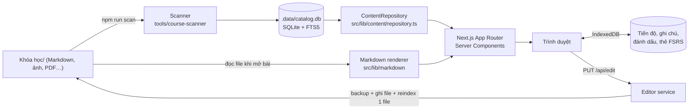

# Kiến trúc CourseFlow

## Lớp dữ liệu

| Lớp | File | Vai trò |
|---|---|---|
| Cấu hình | `src/lib/content/config.ts` | Content roots từ biến môi trường; `resolveInside` chặn path traversal |
| Phân loại | `src/lib/content/classify.ts` | Luật thuần theo tên: thư mục bỏ qua, thư mục tài nguyên/wrapper/dự án code, file tổng quan/tài nguyên/phụ lục |
| Metadata bài | `src/lib/content/lesson-meta.ts` | Frontmatter, H1, mô tả, heading, số từ, câu hỏi, media, liên kết, text chuẩn hóa cho FTS |
| Discovery | `src/lib/content/discovery.ts` | Domain → Category (→ sub-category) → Course → Module (→ nhóm) → Lesson; manifest; ID ổn định; kiểm tra tự động |
| Scanner | `src/lib/content/scanner.ts` | Tăng dần theo mtime/size; bảng `docs` là cache từng file, `docs_fts` là FTS5 contentless; catalog dựng lại mỗi lần (≈40 s) |
| Repository | `src/lib/content/repository.ts` | Interface duy nhất UI dùng: danh mục, khóa, bài, tìm kiếm (MiniSearch cho tên khóa/module, FTS5 cho nội dung), bài liên quan, bảng biên tập |
| Editor | `src/lib/content/editor.ts` | Đọc / lưu (kiểm tra base hash, backup, ghi nguyên tử, giữ CRLF) / lịch sử / reindex một file |
| Render | `src/lib/markdown/*` | `pipeline.ts`: remark-gfm, math, callout, raw HTML đã sanitize, KaTeX. `render.tsx` (server): Shiki, link/ảnh resolve. `LivePreview` (client) cho trình soạn |
| Assessment | `src/lib/assessment/*` | `schema.ts` (Zod), `parse-markdown-quiz.ts`, `grade.ts`, `pool.ts` (đề ngẫu nhiên, thẻ đến hạn), `fsrs.ts` |
| Tiến độ | `src/features/progress/store.ts` | IndexedDB (`idb-keyval`), theo `profile` → mở rộng nhiều tài khoản sau này; xuất/nhập JSON |

## ID ổn định

- Khóa: `slug(tên thư mục)` hoặc `id` trong manifest.
- Bài: `id` trong frontmatter, rồi đến mã kiểu `UD687-S01-L001` / `BL094-S01-L013` trong tên file, cuối cùng là `<khóa>--sha1(đường dẫn trong khóa)`. Vì vậy đổi tiêu đề không làm mất tiến độ; đổi tên file thì mất, trừ khi bài có `id`.
- Thẻ ôn tập: `<lessonId>::sha1(câu hỏi)`, nên đổi thứ tự câu hỏi không làm mất lịch ôn.

## An toàn

- Không truy cập ổ đĩa từ trình duyệt. Mọi file đi qua `/api/asset/<root>/<đường dẫn tương đối>`, có kiểm tra `resolveInside`, danh sách đuôi file cho phép, và CSP `sandbox` (SVG không chạy được script).
- Markdown: raw HTML qua `rehype-sanitize` (không có `script`, `iframe`, `on*`); link `javascript:`, `data:`, `file:` bị coi là hỏng. YouTube chỉ nạp khi người học bấm.
- API không trả đường dẫn tuyệt đối. Ngoại lệ: link `vscode://` chỉ có ở Local Mode, tắt bằng `COURSEFLOW_MODE=public`.
- Ghi file: chỉ `.md` trong content root, có base hash chống ghi đè, backup trước khi ghi, rename nguyên tử.

## Hiệu năng

- Không quét đĩa theo request. Mỗi lần mở bài chỉ đọc đúng một file.
- Lần quét đầu đọc 126k file (~40 phút trên ổ chậm). Các lần sau chỉ stat cây thư mục rồi đọc file đổi.
- Danh sách khóa và chỉ mục MiniSearch được cache theo phiên quét (`meta.last_scan`).
- Mermaid tải lười (dynamic import), Shiki chạy phía server, KaTeX dùng CSS.

## Mở rộng sau

- Semantic search / AI tutor: thêm phương thức vào repository (ví dụ `semanticSearch`) và một bảng embedding. UI search đã tách qua `/api/search`.
- Nhiều tài khoản: đổi `PROFILE` trong store thành id người dùng, hoặc chuyển store sang API phía server.
- Git Repository Mode: trỏ `COURSEFLOW_CONTENT_ROOTS` vào bản clone, chạy `npm run scan` trong CI rồi `npm run build`, đặt `COURSEFLOW_MODE=public`.
